# Sim-to-Real 前沿技术路线调研：视觉真实性、物理可靠性与轨迹多样性

> 更新日期：2026-11-17 · 研究领域：机器人学习 / VLA / 机器人仿真数据 · 主要覆盖：2025—2026 年  
> 本文独立讨论 Sim-to-Real，不以任何特定模型项目为预设研究目标。  
> **图像说明**：各论文下的“官方原图”均链接至作者项目网站或作者公开代码仓库；“方法重绘”是根据论文与项目描述自行整理的 Mermaid 流程图，不是论文原图。由于原图采用外部托管，本地离线阅读可能需要联网。

## 摘要

大规模机器人策略训练面临的 Sim-to-Real Gap 并非单一图像域差异，而是机器人在真实环境中执行时，观测、物理动力学、动作分布、场景初始化及执行反馈发生的**联合分布偏移**。视觉真实性决定模型能否识别场景，物理可靠性决定动作是否产生预期结果，轨迹多样性决定训练是否覆盖部署场景和纠错动作；三者往往互相制约。2025—2026 年的研究正在从简单随机化走向 **可交互数字孪生 + 生成式条件渲染 + 真实物理反馈校准 + 自动数据生产与筛选**。本调研以正式发表、真实机器人证据、公开代码与可审计性为优先标准，分别选取 3、3、4 项代表工作，并补充两篇关于真机—仿真协同训练的研究。

## 1. 总体问题：Sim-to-Real 为什么仍然困难？

### 1.1 四种耦合失配

给定观测 $o_t$、动作 $a_t$、隐状态 $s_t$、语言任务 $l$，策略训练与执行过程可写作：

$$a_t\sim\pi_\theta(a_t\mid o_{\le t},l),\quad s_{t+1}\sim P_{\mathrm{env}}(s_{t+1}\mid s_t,a_t),\quad o_t\sim P_{\mathrm{sensor}}(o_t\mid s_t).$$

从模拟器转移到真实系统时，至少存在以下差异：

1. **视觉/几何差异**：材质、反射、照明、阴影、相机内外参、深度噪声、遮挡、物体尺度、手眼标定，导致 $P_{sim}(o\mid s) \ne P_{real}(o\mid s)$。
2. **物理/控制差异**：摩擦、顺应性、接触刚度、阻尼、碰撞模型、柔性材料、执行器滞后、控制频率、关节死区，导致 $P_{sim}(s'\mid s,a) \ne P_{real}(s'\mid s,a)$。
3. **轨迹与任务覆盖差异**：训练动作由脚本专家或规划器生成，常偏向最短路径、成功结果和少量起始配置；真实动作包含人工停顿、误差恢复、罕见接触和长尾任务。即 $d_{\pi,sim}(s,a) \ne d_{\pi,real}(s,a)$。
4. **Sim/Real 数据组成差异**：数据量、采集策略、相机标定、动作定义、采样率、轨迹质量和任务难度不同；更多模拟样本不必然具有更高的有效训练权重。

### 1.2 成功指标不能互相代替

| 指标 | 衡量什么 | 无法直接证明什么 |
|---|---|---|
| 图像 FID/LPIPS/PSNR | 视觉合成与参考图像的一致性 | 接触动力学正确、机器人执行成功 |
| 模拟器内任务成功率 | 仿真策略是否有效 | 真机中能否克服动态失配 |
| 接触/轨迹预测误差 | 仿真与真机的物理一致性 | 大规模未知任务泛化 |
| 真实机器人成功率（注明次数） | 真实部署性能 | 更换本体、任务和场景后的普适表现 |
| 数据效率（每条真实示教的增益） | 模拟数据是否减少昂贵采集 | 模拟数据质量的全部维度 |

### 1.3 2025—2026 年路线概览

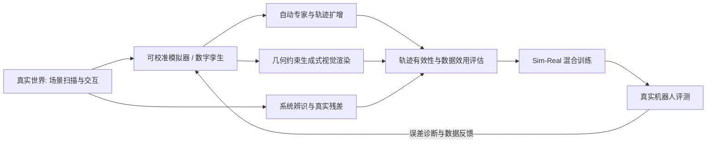

> 此图为调研综合示意，**不是**某一篇论文的方法图。传统域随机化、MimicGen 等依旧重要，但本报告不把它们作为前沿创新的主要代表。

### 1.4 证据等级

- **A（正式发表 + 有机器人实验证据）**：论文有正式会议记录，且包含真实机器人验证或真实物理交互比较。只对论文所覆盖的任务与设置有效。
- **B（前沿预印本 + 有相关实验）**：来源可信且公开完整实验，但缺少正式发表或独立复现；项目有代码不等于已经复现。
- **I（工程基础设施）**：可检查的开源系统，但不能把工具本身当作机器人迁移算法的胜负证据。

---

## 2. 视觉真实性（Visual / Geometric Fidelity）

### 2.1 路线 V1：Real-to-Sim 场景重建与可交互数字孪生 — GSWorld

**论文**：GSWorld: Closed-Loop Photo-Realistic Simulation Suite for Robotic Manipulation（ICRA 2026）  
**机构**：UC San Diego、Meta 等；**等级**：A  
**论文**：[arXiv:2510.20813](https://arxiv.org/abs/2510.20813) · [IEEE 官方记录](https://doi.org/10.1109/ICRA57385.2026.11697084)  
**GitHub**：[luccachiang/GSWorld](https://github.com/luccachiang/GSWorld) · **官网**：[3dgsworld.github.io](https://3dgsworld.github.io/)

**作者原图（开源仓库展示图，非重新绘制）**：

*图源：[GSWorld 官方仓库 resources/teaser.webp](https://github.com/luccachiang/GSWorld/blob/main/resources/teaser.webp)。*

**研究问题**：普通高保真渲染缺乏物理交互与闭环评测能力，单独优化图像无法直接训练机器人策略。

**方法核心**：扫描真实场景和物体，使用 3DGS 获得照片级表示；通过机器人 URDF、几何对齐、碰撞 Mesh 与 Gaussian-on-Mesh 整合为 GSDF 资产，在可执行物理场景中训练与评估策略。其下游包括零样本 Sim-to-Real、DAgger 式纠错采样、策略视觉基准测试与虚拟遥操作。

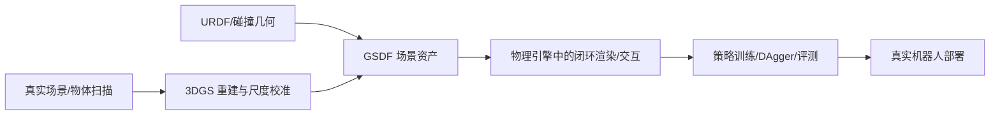

**证据**：ICRA 2026 正式发表；作者展示 FR3、xArm6 和 Galaxea R1 等设置的仿真学习及真实应用。**边界**：场景扫描、尺寸标定及接触参数仍有工作成本；3DGS 逼真不等于物理精确。

### 2.2 路线 V2：几何与照片级外观共同对齐 — RE³SIM

**论文**：RE³SIM: Generating High-Fidelity Simulation Data via 3D-Photorealistic Real-to-Sim for Robotic Manipulation（ICRA 2026）  
**机构**：上海交通大学、上海人工智能实验室、香港大学；**等级**：A  
**论文**：[arXiv:2502.08645](https://arxiv.org/abs/2502.08645) · [IEEE 官方记录](https://doi.org/10.1109/ICRA57385.2026.11695858)  
**GitHub**：[InternRobotics/Re3Sim](https://github.com/InternRobotics/Re3Sim) · **官网**：[re3sim.github.io](https://re3sim.github.io/)

**作者原图（官方 Framework 图）**：

*图源：[RE³SIM 官网 Framework](https://re3sim.github.io/)。*

**研究问题**：真实场景与仿真场景的物体 Mesh、背景外观、相机与机械臂坐标不对齐，使端到端视觉策略难以直接迁移。

**方法核心**：分别恢复前景几何与背景外观，对场景进行多相机/标记物配准及 ICP 精调；将 3DGS 渲染与 Isaac Sim/PhysX 融合；使用脚本策略与拒绝采样收集轨迹，训练模仿学习策略。

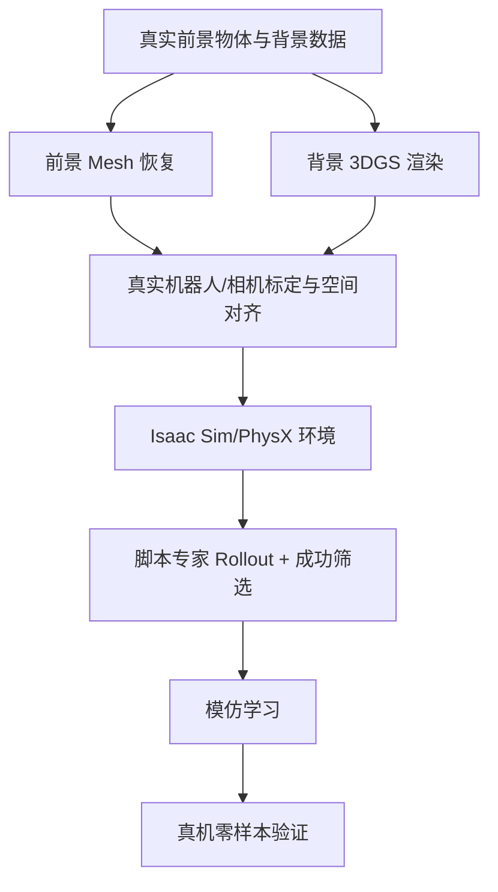

**证据**：作者在四类真实操作任务上报告仅使用模拟轨迹训练时平均成功率超过 58%；代码已公开。**边界**：此结果是论文所研究的相对固定场景与任务，不能外推为任意环境 58% 的普适成功率。

### 2.3 路线 V3：生成式视觉仿真 — RoboRender

**论文**：RoboRender: Robot-Oriented Video Generation for Visual Sim-to-Real Transfer（2026-10 预印本）  
**机构**：Stanford、NVIDIA、Microsoft Research；**等级**：B  
**论文**：[arXiv:2610.09254](https://arxiv.org/abs/2610.09254)  
**GitHub**：[robo-render/RoboRender-Video-Model](https://github.com/robo-render/RoboRender-Video-Model) · **官网**：[robo-render.github.io](https://robo-render.github.io/)

**作者原图（官方视频生成模型结构）**：

*图源：[RoboRender 官网 Video Model](https://robo-render.github.io/)。*

**研究问题**：物理模拟器可以输出动作和几何，但图像纹理、反射、光照与真实场景相差较大。简单 Domain Randomization 很难产生符合真实机器人视觉分布的动态视频。

**方法核心**：收集模拟器的同步多视角深度视频、机器人 RGB/Mask、指令及动作；训练机器人定向视频扩散模型，生成具有真实材料和背景的多视角 RGB 视频；仍然使用仿真器原始状态与动作作监督。支持分段自回归生成、干扰物插入及新本体外观。

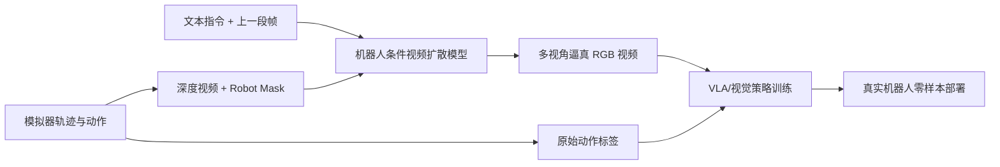

**证据**：作者在 8 项真实机器人任务、每项 10 次执行的设置中报告平均成功率 71%，优于原始仿真 10% 和视觉随机化 20%。**重要限定**：策略未使用真实示教微调，但视频生成模型**使用约 13 万个真实机器人操作视频样本训练**，因此不能宣称整个数据生成系统不依赖真实数据；生成视频还需检查几何与接触条件一致性。代码已公开，但新论文的跨任务可靠性仍待独立复现。

### 2.4 视觉方向判断

| 路线 | 方法的核心变量 | 强项 | 未解决问题 |
|---|---|---|---|
| GSWorld | 可交互数字孪生与 GSDF | 闭环与评估 | 扫描、标定、碰撞资产成本 |
| RE³SIM | 前景 Mesh + 背景 3DGS + 真实配准 | 固定场景零样本迁移 | 开放场景与动态物体扩展 |
| RoboRender | 深度/Mask 约束的视频生成 | 外观与视觉域迁移 | 生成时序与接触真实性、生成成本 |

**综合认识**：可交互数字孪生负责**动作和几何确定性**，生成式视频负责**外观多样化**。二者可组合，但真实感不能代替物理一致性。

---

## 3. 物理可靠性（Physical Fidelity / Contact Robustness）

### 3.1 路线 P1：真实残差强化学习补偿仿真误差 — SPARR

**论文**：SPARR: Simulation-based Policies with Asymmetric Real-world Residuals for Assembly（ICRA 2026）  
**机构**：NVIDIA Research；**等级**：A  
**论文**：[arXiv:2602.23253](https://arxiv.org/abs/2602.23253) · **官网**：[NVIDIA Research SPARR](https://research.nvidia.com/labs/srl/projects/sparr/)  
**GitHub**：[NVlabs/SPARR](https://github.com/NVlabs/SPARR)

**作者原图（官方 Pipeline Overview）**：

*图源：[NVIDIA SPARR 官方项目](https://research.nvidia.com/labs/srl/projects/sparr/)。*

**研究问题**：装配接触涉及小误差放大，固定物理模型中的高成功率策略，在真机上可能因为摩擦、定位偏差和力控误差失败；纯真机强化学习从零探索又昂贵。

**方法核心**：仿真训练基于低维状态的基础策略，真机先收集其成功 Rollout，随后利用相机与本体感觉学习残差策略。实际动作为：

$$a_t = a_t^{base}(s_t) + \Delta a_t^{residual}(o_t,q_t).$$

真实残差训练使用稀疏奖励与示教/在线交互缓冲区。

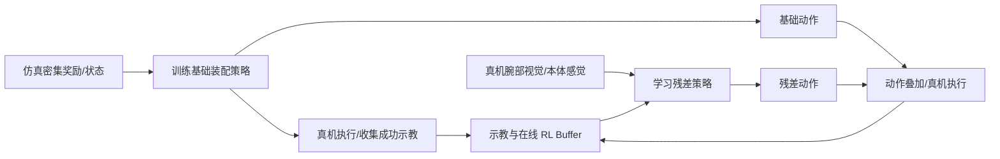

**证据**：10 项真实装配任务；作者报告相对所比较的零样本 Sim-to-Real 方法，成功率相对改善 38.4%，周期相对缩短 29.7%。**关键限定**：高成功率是在进行**真实残差学习之后**得到，并非纯仿真零样本结果；对无安全可探索空间的任务仍需谨慎。

### 3.2 路线 P2：真实交互驱动的神经软体仿真 — SoMA

**论文**：SoMA: A Real-to-Sim Neural Simulator for Robotic Soft-Body Manipulation（ICML 2026）  
**机构**：复旦大学、上海人工智能实验室、上海交通大学、香港中文大学、香港大学；**等级**：A  
**论文**：[ICML 正式论文](https://proceedings.mlr.press/v306/huang26bh.html) · [arXiv:2602.02402](https://arxiv.org/abs/2602.02402)  
**GitHub**：[Wrioste/SoMA](https://github.com/Wrioste/SoMA) · **官网**：[SoMA](https://city-super.github.io/SoMA/)

**作者原图（官方 SoMA framework）**：

*图源：[SoMA 官方项目](https://city-super.github.io/SoMA/)。*

**研究问题**：布料、绳索、柔性玩具等物体的真实接触与变形，很难用固定的刚体动力学参数表达；真实操作会引起复杂遮挡与长时程误差累积。

**方法核心**：从真实 RGB 观测和机器人关节动作中重建分层 Gaussian Splat，学习包含机器人与环境受力的潜空间变形动力学，使用粗时间尺度先训练整体运动、再用细尺度学习接触与局部变化。

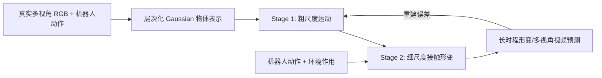

**证据**：ICML 2026 正式发表，作者报告在真实机器人交互的重新模拟及泛化指标上改善约 20%，覆盖布料、绳索等物体。**关键限定**：该数值是模拟精度/泛化相关结果，**不是** VLA 真机成功率改善 20%；柔性物体优先，不可直接外推至所有刚体装配。

### 3.3 路线 P3：可微物理参数辨识 + 物理数字近邻 — PIN-WM

**论文**：PIN-WM: Learning Physics-INformed World Models for Non-Prehensile Manipulation（RSS 2025）  
**机构**：国防科技大学、武汉大学、深圳大学等；**等级**：A  
**论文**：[RSS 正式论文](https://roboticsproceedings.org/rss21/p153.html) · [arXiv:2504.16693](https://arxiv.org/abs/2504.16693)  
**GitHub**：[XuAdventurer/PIN-WM](https://github.com/XuAdventurer/PIN-WM) · **官网**：[PIN-WM](https://pinwm.github.io/)

**作者原图（官方 Method）**：

*图源：[PIN-WM 官方项目](https://pinwm.github.io/)。*

**研究问题**：推动、拨动、滑动等非抓取操作对摩擦、恢复系数等参数敏感，人工设置物理范围不能保证真实一致。

**方法核心**：利用少量与任务无关的真实物理交互，通过 2D Gaussian Splat 渲染的观测损失，配合基于 LCP 的可微刚体动力学，端到端辨识物理参数；随后在辨识结果附近对物理与视觉参数作有意义的扰动，形成 Digital Cousins，用于策略学习和真机迁移。

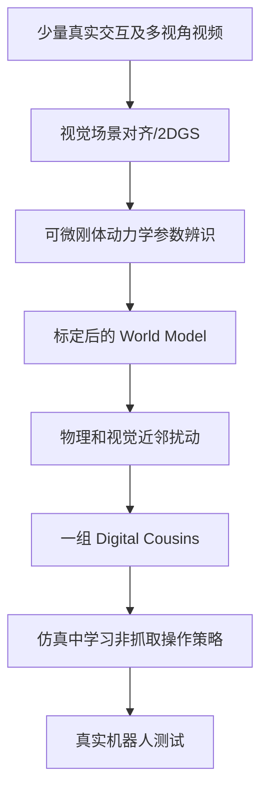

**证据**：RSS 2025 正式发表，有真实机器人操作的 Sim-to-Real 实验和代码。**边界**：主要是非抓取刚体操作；模型结构与控制形式不能直接迁移到布料或多臂复杂装配。

### 3.4 物理基础设施补充：Newton（不计作一篇算法胜负论文）

**项目**：[NVIDIA Newton Physics](https://github.com/newton-physics/newton) · **参与机构**：NVIDIA / Google DeepMind / Disney Research。Newton 是面向机器人动力学、接触及可微多物理求解的开源基础设施；其优势是可扩展的物理求解与 GPU 计算。**使用它并不自动缩小 Sim-to-Real Gap**，仍需要对碰撞几何、摩擦与真实系统进行校准。它是上述 P1–P3 路线可能依赖的工具层，不宜与策略迁移算法直接比较成功率。

### 3.5 物理方向判断

| 路线 | 优化对象 | 接触类型 | 核心局限 |
|---|---|---|---|
| SPARR | 真机残差策略 | 刚体精细装配 | 真机在线探索与奖励、安全约束 |
| SoMA | 数据驱动软体动力学 | 柔性物体 | 所需真实交互数据与物体分布 |
| PIN-WM | 可微系统辨识与数字近邻 | 刚体非抓取 | 可微求解模型假设与辨识不确定性 |

---

## 4. 轨迹多样性（Trajectory / Skill / Outcome Diversity）

### 4.1 路线 T1：MLLM 自动专家程序 + 仿真自修复 — RoboTwin 2.0

**论文**：RoboTwin 2.0: A Scalable Data Generator and Benchmark with Strong Domain Randomization for Robust Bimanual Robotic Manipulation（ICML 2026）  
**机构**：上海交通大学、上海人工智能实验室、香港大学等；**等级**：A  
**论文**：[ICML 2026 正式论文](https://proceedings.mlr.press/v306/chen26j.html)  
**GitHub**：[RoboTwin-Platform/RoboTwin](https://github.com/RoboTwin-Platform/RoboTwin) · **官网**：[RoboTwin](https://robotwin-platform.github.io/)

**作者原图（官方项目总览/Teaser）**：

*图源：[RoboTwin 官方主页](https://robotwin-platform.github.io/)。此图为作者总览展示图，方法细节以论文和下方流程图为准。*

**研究问题**：双臂复杂任务生成专家轨迹的人工编程成本高，脚本专家容易在新任务/新物体配置下执行失败；数据多样性仍受场景初始化限制。

**方法核心**：利用多模态模型辅助生成专家任务程序，把程序投入物理仿真、观察失败、反馈修改，得到可执行专家；再通过环境、物体、语言、初态、本体等变化收集大量轨迹，提供统一基准训练和评估。

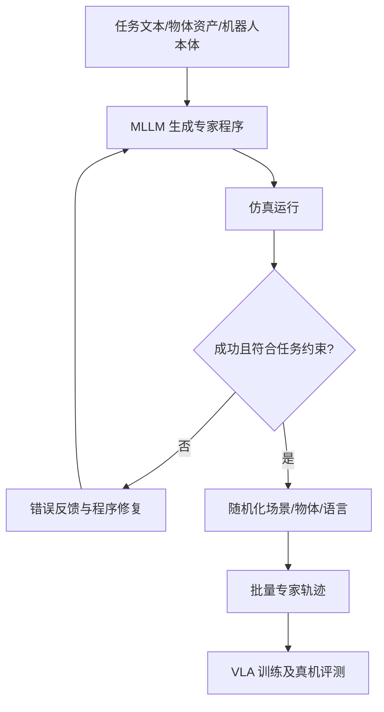

**证据**：50 项双臂任务、5 种本体；作者报告其合成数据预训练在特定真机实验中达到相应少样本基线的 3.6 倍和零样本基线的 2.2 倍。**边界**：提升由专家程序、数据规模、视觉空间随机化共同产生，不能完全归功于“轨迹多样性”。

### 4.2 路线 T2：组合式世界模型重新生成示教 — RoboDream

**论文**：RoboDream: Compositional World Models for Scalable Robot Data Synthesis（IROS 2026；以作者当前仓库信息为准）  
**机构**：USC / Toyota Research Institute；**等级**：A（论文会议记录需与正式 proceedings 版本进一步交叉核对，真实机器人数据已公开）  
**论文**：[arXiv:2606.02577](https://arxiv.org/abs/2606.02577)  
**GitHub**：[Jay-Ye/RoboDream](https://github.com/Jay-Ye/RoboDream) · **官网**：[RoboDream](https://junjieye.com/RoboDream/)

**作者原图（官方仓库展示动画）**：

*图源：[RoboDream 开源仓库 assets/teaser.gif](https://github.com/Jay-Ye/RoboDream/blob/main/assets/teaser.gif)；为作者主展示动画，不冒充论文 Fig. 1。*

**研究问题**：单纯替换图像背景仅增加外观多样性，随机生成视频又可能发生机器人本体幻觉与运动不一致。如何重用真实运动并合成新物体、新场景及相机视角？

**方法核心**：把机器人运动作为显式约束，分别使用机器人单独渲染的视频、场景先验、物体先验及任务指令控制生成。支持“检索旧轨迹并在新场景重生”（Retrieval & Rebirth）和“无实体道具遥操作”（Prop-Free Teleoperation）。

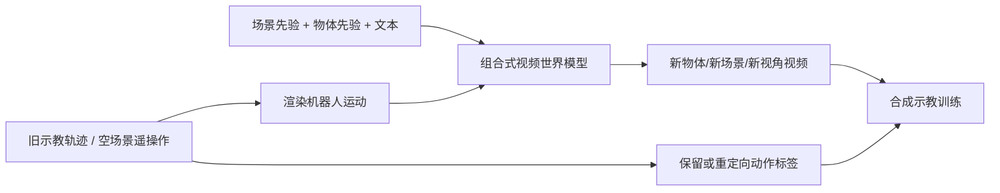

**证据**：官方页面报告 4 个真机任务上，50 条真实示教的 36.3% 平均成功率，加入 100 条合成示教后达到 62.5%。**边界**：这个结果依赖特定真实/生成数据配比；新对象接触的力学可行性仍需额外验证。**代码状态**：作者 GitHub 当前已包含生成/演示代码，先前网页“coming soon”提示存在版本差异，以仓库实时状态为准。

### 4.3 路线 T3：不求解完整动力学的低成本机器人数据合成 — Real2Render2Real

**论文**：Real2Render2Real: Scaling Robot Data Without Dynamics Simulation or Robot Hardware（CoRL 2025）  
**机构**：UC Berkeley / Toyota Research Institute；**等级**：A  
**论文**：[CoRL 2025 正式论文](https://proceedings.mlr.press/v305/yu25a.html)  
**GitHub**：[uynitsuj/real2render2real](https://github.com/uynitsuj/real2render2real) · **官网**：[Real2Render2Real](https://real2render2real.github.io/)

**作者原图（官网关键实验图：数据采集时间与真机成功率，非模型结构图）**：

*图源：[Real2Render2Real 官方项目](https://real2render2real.github.io/)；完整论文方法图请见 [CoRL 正式论文](https://proceedings.mlr.press/v305/yu25a.html)。*

**研究问题**：真实遥操作贵，完整物理轨迹仿真也可能贵而不准；若任务适合从运动学重定向构造示教，是否可以跳过物体动力学求解？

**方法核心**：手机扫描物体及其三维外观、一段人类示范，追踪 6DoF 物体运动，结合 3DGS 渲染和逆运动学生成多本体可用的操作视频与状态—动作标签；利用 IsaacLab 渲染，但关闭物体碰撞动力学求解。

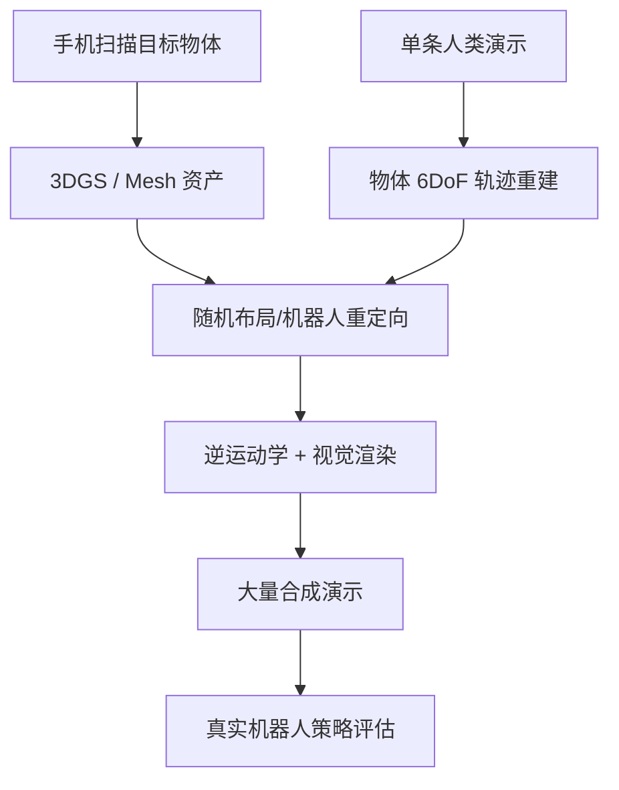

**证据**：CoRL 2025，真实机器人测试，论文报告单条人类示范生成的数据在其任务上可接近 150 条遥操作示教的效果。**边界**：不求解接触动力学意味着更难验证碰撞、力和物体非刚性变形；不适合作为所有任务的物理准确数据来源。

### 4.4 路线 T4：有效数据选择而非单纯增加条数 — SCIZOR

**论文**：SCIZOR: A Self-Supervised Approach to Data Curation for Large-Scale Imitation Learning（ICRA 2026 Oral）  
**机构**：UT Austin / NVIDIA；**等级**：A  
**论文**：[arXiv:2505.22626](https://arxiv.org/abs/2505.22626) · [UT Austin 论文记录](https://rpl.cs.utexas.edu/publications/2026/06/01/zhang-icra26-scizor/)  
**GitHub**：[UT-Austin-RPL/SCIZOR](https://github.com/UT-Austin-RPL/SCIZOR) · **官网**：[SCIZOR](https://ut-austin-rpl.github.io/SCIZOR/)

**作者原图（论文 Figure 1；官网同图）**：

*图源：[SCIZOR 官网](https://ut-austin-rpl.github.io/SCIZOR/)；对应论文 Fig. 1。*

**研究问题**：大量数据中存在动作停顿、无任务进展和高度重复的状态—动作片段，这些片段会稀释模仿学习的有效监督。

**方法核心**：利用自监督的时间进度预测剔除不利于目标达成的转移，利用视觉—动作联合表征与相似度聚类去重，在 transition 级别而非整个 Episode 级别筛选数据。

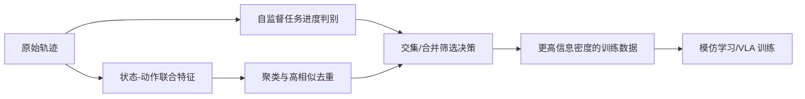

**证据**：ICRA 2026 Oral；作者报告多个评测设置下平均改善约 15.4%。**关键限定**：这是一种针对**模仿学习目标**的数据筛选，不能因此认为失败/无进展片段对动力学预测与世界模型一律无价值。

### 4.5 轨迹方向判断

| 路线 | 扩增/优化对象 | 对应解决的问题 | 需要的防护 |
|---|---|---|---|
| RoboTwin 2.0 | 任务程序 + 专家 Rollout | 专家构造昂贵、双臂协调失败 | 真实接触与任务验证 |
| RoboDream | 视觉与语义重新组合 | 新物体、新场景、新视角 | 物理标签一致性 |
| Real2Render2Real | 重定向运动学演示 | 真机遥操作成本 | 碰撞/力学可行性 |
| SCIZOR | 数据质量及信息密度 | 重复、停滞、次优动作 | 区分策略监督与动力学监督 |

---

## 5. 真机数据与仿真数据如何权衡？（交叉议题）

以上三个问题相互作用，不能靠一个全局固定比例（如 80:20）解决。应当单独研究 **真实示教数、模拟轨迹数、采样权重、模拟生成策略、性能饱和点**。

### 5.1 MetaGenSim：主动优化“应生成什么数据”

**论文**：Active Generative Simulation: Meta-Learning What to Simulate for Sim-and-Real Policy Co-Training（CoRL 2026，作者项目如此标注）  
**机构**：Georgia Tech；**等级**：B（作者实验可信、代码尚未公开）  
**论文**：[arXiv:2610.19479](https://arxiv.org/abs/2610.19479) · **官网**：[MetaGenSim](https://meta-gensim.github.io/)  
**GitHub**：**暂无公开可复现代码**（截至 2026-11-17，项目页标注 `Code (coming soon)`）。

**作者原图（官方方法图）**：

*图源：[MetaGenSim 官方项目](https://meta-gensim.github.io/)。*

**方法核心**：元学习数据评分器；估计哪些模拟生成参数能更好改善少量真实数据的训练目标；拟合参数效用密度；主动生成针对性数据并与真实示教混合训练。

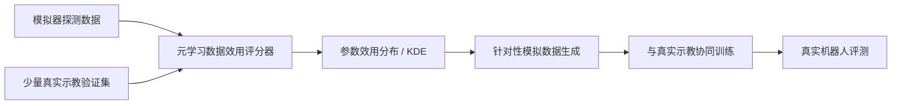

**证据**：作者项目报告 4 项真实操作任务，每项 10 条真实示教，完整任务成功次数 58/80，对照均匀生成 23/80。**边界**：研究依赖元学习代理的效用预测能力，且代码尚未公开，不应将其复现成熟度等同于 RoboTwin。

### 5.2 Sim-and-Real Co-Training：明确研究混合训练，而不是只拼接数据

**论文**：Sim-and-Real Co-Training: A Simple Recipe for Vision-Based Robotic Manipulation（RSS 2025）  
**机构**：UT Austin / NVIDIA / UC Berkeley；**等级**：A  
**论文**：[arXiv:2503.24361](https://arxiv.org/abs/2503.24361) · **项目主页**：[官方主页](https://co-training.github.io/)  
**核心观点**：任务感知数字近邻、仿真与真实数据联合训练可以缓解有限真实示教的瓶颈。必须分别检查真实与模拟的相机、初始状态、任务和动作定义，训练权重不等于数据集样本数量比。

**分析框架（调研重绘）**：

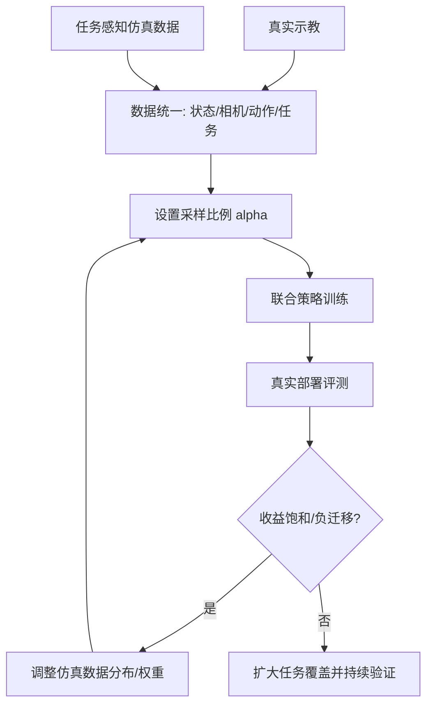

训练混合形式可表示为 $\mathcal{L}=(1-\alpha)\mathcal{L}_{real}+\alpha\mathcal{L}_{sim}$。但必须记录 **每个 batch 的域抽样概率**，不能只报告原始数据大小。推荐报告多点比例消融（仅真实、低/中/高 sim 比例、仅仿真），控制总训练步数，并附置信区间。

---

## 6. 综合对比与复现优先级

| 方向 | 工作 | 机构 | 证据 | 官方代码 | 最推荐阅读的理由 |
|---|---|---|---|---|---|
| 视觉 | GSWorld | UCSD/Meta | A | 有 | 数字孪生进入闭环训练 |
| 视觉 | RE³SIM | SJTU/上海AI Lab/HKU | A | 有 | 可测的 Real-to-Sim 几何视觉对齐 |
| 视觉 | RoboRender | Stanford/NVIDIA/Microsoft | B | 有 | 明确控制动作与真实视频外观 |
| 物理 | SPARR | NVIDIA | A | 有 | 真机残差学习替代苛求完美仿真 |
| 物理 | SoMA | 复旦/上海AI Lab 等 | A | 有 | 柔性物体动作条件神经动力学 |
| 物理 | PIN-WM | 国防科大/武汉大学等 | A | 有 | 视觉损失驱动的可微系统辨识 |
| 轨迹 | RoboTwin 2.0 | SJTU/上海AI Lab 等 | A | 有 | 自动程序修复与大量可执行轨迹 |
| 轨迹 | RoboDream | USC/TRI | B | 有（已核验代码） | 运动与场景分离，生成新示教 |
| 轨迹 | Real2Render2Real | Berkeley/TRI | A | 有 | 无需完整物理求解的低成本数据生成 |
| 轨迹 | SCIZOR | UT Austin/NVIDIA | A | 有 | transition 级有效数据筛选 |
| 跨议题 | MetaGenSim | Georgia Tech | B | 暂无 | 直接优化模拟数据生成分布 |
| 跨议题 | Sim-and-Real Co-Training | UT Austin/NVIDIA/Berkeley | A | 项目页查验 | 数据混合的直接实验证据 |

## 7. 开放问题与研究判断

**视觉问题：** 视觉生成器的跨视角一致性是否可靠？深度和掩码约束能否保证接触前后不发生几何漂移？是否存在“生成质量上升但动作预测退化”的反例？

**物理问题：** 在动态模型不完美的情况下，应该将预算投入更准确的求解器、少量真实交互辨识，还是残差控制？这可能依赖任务：精密插入更需要安全接触控制；柔性物体更依赖数据驱动神经动力学。

**轨迹问题：** 新增轨迹究竟扩展了多少**新的状态—动作—结果关系**？在同样的采样预算下，任务组合、接触模式、动作恢复和场景分布哪个更有价值？必须根据学习目标区分失败数据的用途。

**共同结论：** 高真实感、高物理精度与高多样性不是一个可以单独最大化的指标。更可靠的研究范式是 **真实场景/交互标定 → 可控生成 → 物理与数据质量验证 → 真实部署评估 → 误差驱动再生成**。不要将论文中不同任务、不同本体、不同数据预算下的成功率横向排序为统一 SOTA。

## 8. 阅读与引用规范

1. 优先引用论文正式 proceedings / DOI；没有正式版本时标记 arXiv 日期。
2. 每篇论文记录 5 项信息：任务/机器人、真机评测次数、真实数据使用方式、代码与权重是否公开、作者所声明的限制。
3. 官方论文插图使用**原作者托管图片链接**；插图权利归原作者，不应移除其来源与署名。
4. 本文所有 Mermaid 流程图均为中文解读，不应在二次论文中标注为原作 Figure。
5. 定期核实 `main` 分支与项目页的版本变动，特别是 “Code coming soon” 状态与论文录用信息。

## 9. 原始论文与项目链接（便于批量导入文献管理器）

| 编号 | 论文 | 论文页面 | GitHub |
|---|---|---|---|
| V1 | GSWorld | https://arxiv.org/abs/2510.20813 | https://github.com/luccachiang/GSWorld |
| V2 | RE³SIM | https://arxiv.org/abs/2502.08645 | https://github.com/InternRobotics/Re3Sim |
| V3 | RoboRender | https://arxiv.org/abs/2610.09254 | https://github.com/robo-render/RoboRender-Video-Model |
| P1 | SPARR | https://arxiv.org/abs/2602.23253 | https://github.com/NVlabs/SPARR |
| P2 | SoMA | https://proceedings.mlr.press/v306/huang26bh.html | https://github.com/Wrioste/SoMA |
| P3 | PIN-WM | https://roboticsproceedings.org/rss21/p153.html | https://github.com/XuAdventurer/PIN-WM |
| T1 | RoboTwin 2.0 | https://proceedings.mlr.press/v306/chen26j.html | https://github.com/RoboTwin-Platform/RoboTwin |
| T2 | RoboDream | https://arxiv.org/abs/2606.02577 | https://github.com/Jay-Ye/RoboDream |
| T3 | Real2Render2Real | https://proceedings.mlr.press/v305/yu25a.html | https://github.com/uynitsuj/real2render2real |
| T4 | SCIZOR | https://arxiv.org/abs/2505.22626 | https://github.com/UT-Austin-RPL/SCIZOR |
| R1 | MetaGenSim | https://arxiv.org/abs/2610.19479 | 未公开 |
| R2 | Sim-and-Real Co-Training | https://arxiv.org/abs/2503.24361 | 项目主页查验 |
