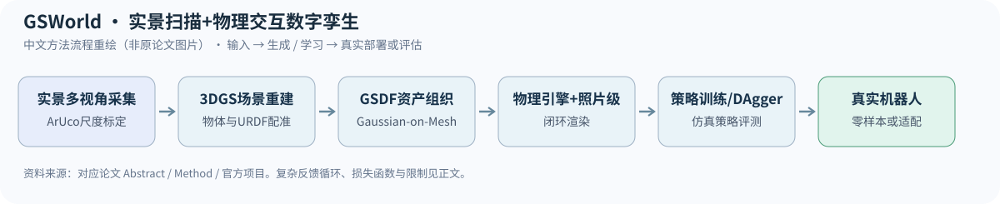
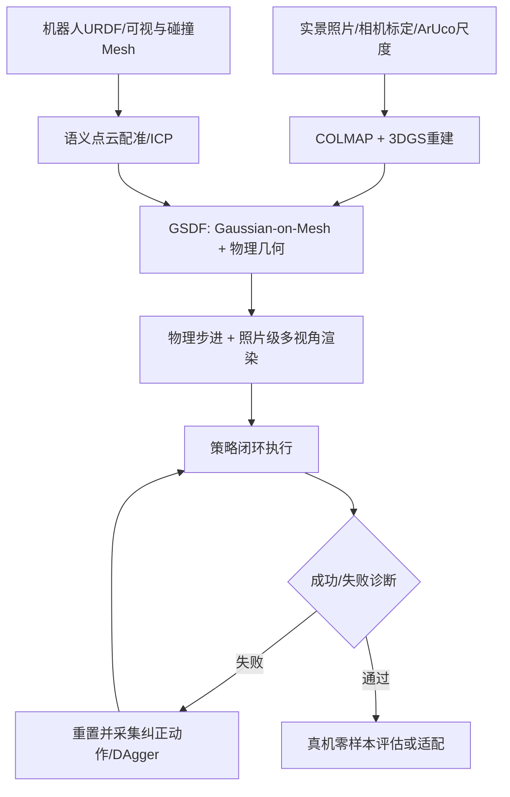
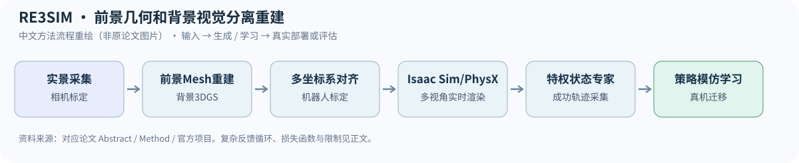
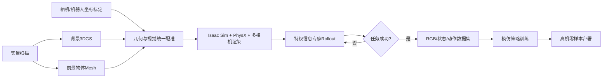
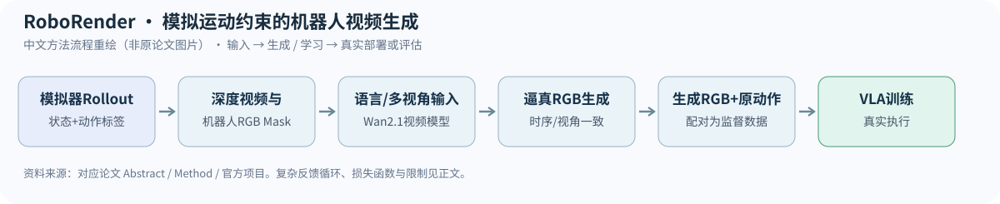
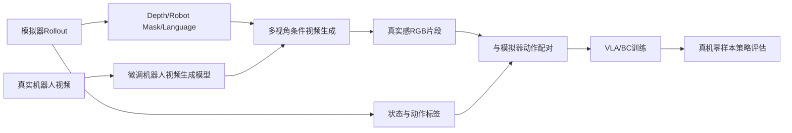

# 2. 视觉真实性：从“逼真图像”到可执行、可监督的数字世界

视觉域差异既包括纹理/光照/遮挡这样的外观差异，也包括相机内外参、物体尺度、几何遮挡和机器人与场景配准这样的结构差异。视觉 Sim-to-Real 的训练对象并非静态图片，而是观测—动作序列，因此还必须检查**跨视角一致性、时间连续性、运动几何与动作标签的一致性**。本章按“可交互数字孪生 → 实景重建数据生产 → 生成式视频渲染”的技术发展展开。

## 2.1 GSWorld：闭环照片级机器人模拟器

### ① 论文基本信息
- **原题**：GSWorld: Closed-Loop Photo-Realistic Simulation Suite for Robotic Manipulation
- **作者/机构**：Guangqi Jiang 等；UC San Diego、UCLA、Meta。
- **发表**：ICRA 2026；[论文（arXiv）](https://arxiv.org/abs/2510.20813)｜[IEEE 记录](https://doi.org/10.1109/ICRA57385.2026.11697084)｜[官方项目](https://3dgsworld.github.io/)｜[GitHub](https://github.com/luccachiang/GSWorld)。

### ② 论文概述（根据原文 Abstract 忠实中文译述）
GSWorld 提出一种把三维高斯泼溅（3DGS）与物理引擎结合的照片级机器人操作模拟器。作者强调建立一个闭环开发环境：一方面，对从真实机器人数据学到的策略进行可复现评估；另一方面，在不额外使用真实机器人训练数据的情况下，直接生成可用于 Sim-to-Real 的数据。为兼顾渲染、机器人结构与物体几何，工作提出 GSDF（Gaussian Scene Description File）资产格式，将 Gaussian-on-Mesh、机器人 URDF 与场景物体统一管理；同时形成涵盖三类机器人本体、四十余种物体的资产库。作者展示了视觉模仿学习的零样本迁移、DAgger 自动纠错、仿真基准评测、虚拟遥操作以及视觉强化学习等应用。

### ③ 研究动机与核心问题
纯 3DGS 重建可以让相机图片接近真实世界，但无法提供碰撞、物体可操作状态和下一步动作反馈；传统物理仿真虽可交互，却又存在明显的纹理、光照和场景几何偏差。因此，论文追求的不是“渲染最美”的静态场景，而是**照片级反馈和真实动作接口在同一个模拟系统内闭环运行**。它在研究对象上更接近可执行数字孪生，而非单纯的数据增强器。

### ④ 方法总览与论文主图
- [官方论文 Figure 1（PDF 第 1 页）](https://3dgsworld.github.io/resources/gsworld.pdf#page=1)；[作者仓库展示图（大文件，按需打开）](https://github.com/luccachiang/GSWorld/blob/main/resources/teaser.webp)。
- Figure 1 左侧说明场景与机器人资产构建，中间说明 Real-to-Sim 的空间对齐，右侧列出 DAgger、RL 和视觉模仿学习等闭环应用。图的关键不是某个单一网络，而是 **GSDF 场景资产 → 渲染与物理联合模拟 → 策略交互** 的系统架构。

### ⑤ 核心技术与算法细节
**步骤一，真实场景尺度恢复。** 使用多视角采集、COLMAP 相机位姿估计和 ArUco 尺度基准，训练具有公制尺度的 3DGS；这一步解决“图片相似但实际米制尺寸不正确”的问题。官方脚本提供 COLMAP/GS 训练及资产导出接口。

**步骤二，机器人与环境联合表示。** 从 URDF 可视 Mesh 中采样有语义的机器人点云，将它与重建的场景点云对齐，先做人工初始配准，再使用 ICP 精调；通过机器人 link 信息保留可操纵部件语义。Gaussian 用于外观渲染，碰撞几何与关节约束仍交给物理系统处理，避免将 3DGS 本身当作可碰撞物理体。

**步骤三，GSDF 资产封装。** GSDF 在同一场景描述中组织 3DGS、Gaussian-on-Mesh、URDF/物体几何和坐标变换，使视觉渲染和物理交互能够持续同步。

**步骤四，闭环数据生产与策略学习。** 在模拟器中运行像素输入、动作输出的策略，实时产生下一帧观测；还支持将失败状态重置并重规划，在 DAgger 流程中采集纠正动作。它的“闭环”主要指训练、测试、定位失败与再采样都在可执行仿真内完成，并不等价于已经消除接触物理误差。

**数据接口与前提。** 需要真实场景的多视角扫描、机器人 URDF、机器人与物体的几何资产及校准结果。初始建模、相机/手眼标定和碰撞属性仍会影响最终精度。

### ⑥ 完整 Pipeline（中文重绘）

### ⑦ 实验设计与主要结果
作者展示 FR3、xArm6 等设置下的模拟数据生产，以及零样本视觉模仿学习、视觉 RL、DAgger 和策略模拟评估。研究目标是说明一套系统可以同时支持多种训练/评测工作流，而不是通过统一的任务集证明它对所有接触任务都优于 PhysX、MuJoCo 或其他引擎。评价时应把图像外观、动作接口匹配、任务成功率和物理精度分别记录。

### ⑧ 方法特点与局限性
**特点**：把几何/视觉资产与物理引擎连接成真正可执行的照片级场景；支持数据闭环，不仅输出离线图片。**局限**：每个目标场景仍有扫描、配准、资产清理与参数辨识成本；精细接触、摩擦和柔性物体的准确性不由 3DGS 保证；其优势在闭环系统能力，不能简单理解为 3DGS 提升了全部策略性能。

---

## 2.2 RE³SIM：前景几何与背景外观共同对齐

### ① 论文基本信息
- **原题**：RE³SIM: Generating High-Fidelity Simulation Data via 3D-Photorealistic Real-to-Sim for Robotic Manipulation
- **作者/机构**：Xiaoshen Han 等；上海交通大学、上海人工智能实验室、香港大学。
- **发表**：ICRA 2026；[论文](https://arxiv.org/abs/2502.08645)｜[IEEE 记录](https://doi.org/10.1109/ICRA57385.2026.11695858)｜[官方项目](https://re3sim.github.io/)｜[GitHub](https://github.com/InternRobotics/Re3Sim)。

### ② 论文概述（根据原文 Abstract 忠实中文译述）
机器人真实世界数据昂贵，需要有经验的操作人员和硬件；仿真具有规模优势，但几何与视觉失配常阻碍策略迁移。RE³SIM 为此提出照片级的 Real-to-Sim 系统，使用三维重建和神经渲染还原真实操作场景，使基于物理的模拟器能够实时渲染不同摄像机视角。作者借助仿真内的特权状态高效采集专家示教，并通过模仿学习训练策略，在多类机器人操作任务中验证 Real-to-Sim-to-Real 流程。仅利用合成训练数据，论文报告平均超过 58% 的真实机器人零样本成功率；进一步扩展模拟数据规模，在不同物体间训练更具泛化性的策略。

### ③ 研究动机与核心问题
将真实环境的照片“贴”到模拟器背景上远远不够。机械臂/物体的几何大小、坐标系和相机视角只要有误差，就会造成训练时的抓取像素与真实操作位置不一致。RE³SIM 的研究重点是**将前景可碰撞几何与背景视觉重建分开处理、再统一配准到真实机器人的几何坐标系**。

### ④ 方法总览与论文主图
- [作者原始方法主图 Framework（官方 PNG）](https://re3sim.github.io/static/images/pipeline.png)｜[对应论文 PDF](https://arxiv.org/pdf/2502.08645)。
- 原图依次展示：前景对象建模、背景视觉重建、机器人/相机对齐、物理场景搭建、脚本专家生成示教，以及从模拟数据训练后部署真机。注意这里的“高视觉真实感”针对可见背景；物体运动与碰撞仍由几何和 PhysX 负责。

### ⑤ 核心技术与算法细节
**步骤一，场景解耦重建。** 将需要碰撞和抓取的操作对象恢复为显式 Mesh，将静态场景背景重建为 3DGS；这样不必用单一表示承担视觉和动力学两类相互矛盾的职责。

**步骤二，几何尺度与坐标对齐。** 利用真实机器人、相机内外参和标记物对目标场景配准；将前景 Mesh、背景 Gaussian、机器人模型映射到共同世界坐标系，必要时通过 ICP 等几何配准细化。偏差会直接转化为抓取与放置的坐标误差。

**步骤三，可执行仿真。** 在 NVIDIA Isaac Sim / PhysX 中保留真实的机器人结构、物体碰撞和运动学约束，使用 3DGS 合成多摄像机 RGB 观测。相同相机配置用于记录仿真动作与视觉观测，保障训练与部署的视觉接口尽量一致。

**步骤四，特权专家数据生成。** 使用仿真中精确可用的物体位姿、目标位姿和机器人状态，运行专家策略完成任务；保存成功的轨迹，过滤失败的 Rollout，再用这些带动作标签的数据训练模仿学习策略。这一设计通过“仿真特权状态生成专家、像素策略学习执行”降低真实遥操作需求。

**步骤五，扩增与联合训练。** 工作考察生成数据规模与成功率之间的关系，并对真实与仿真轨迹的轨迹长度、运动风格差异进行讨论。视觉接近并不等于动作统计分布完全一致。

### ⑥ 完整 Pipeline（中文重绘）

### ⑦ 实验设计与主要结果
作者选取四类真实操作任务，报告仅使用仿真示教训练的平均零样本成功率超过 58%。项目页还展示 3DGS 背景的 PSNR/SSIM 对比、任务级数据采集效率（在 8 张 RTX 4090 上，按任务生成 100 条轨迹通常需数分钟至十余分钟），并分析扩大样本规模后的饱和效应。上述指标来自不同实验设置，不能将“重建质量好”直接等同于“动作动力学完美”。

### ⑧ 方法特点与局限性
**特点**：系统性处理前景几何、背景外观、相机配准和示教采样流程；提供较直接的零样本真实测试。**局限**：固定场景依赖建模/校准；特权专家的成功轨迹不包含全部失败/纠错行为；每个新场景重建的人工与算力成本不能忽略；物理参数误差依旧会残留。

---

## 2.3 RoboRender：保持轨迹条件的生成式视觉 Sim-to-Real

### ① 论文基本信息
- **原题**：RoboRender: Robot-Oriented Video Generation for Visual Sim-to-Real Transfer
- **作者/机构**：Huang Huang 等；Stanford University、NVIDIA、Microsoft Research。
- **状态**：2026 年 10 月 arXiv 预印本；[论文](https://arxiv.org/abs/2610.09254)｜[官网](https://robo-render.github.io/)｜[GitHub](https://github.com/robo-render/RoboRender-Video-Model)。

### ② 论文概述（根据原文 Abstract 忠实中文译述）
仿真能够低成本产生大量机器人轨迹，但模拟图片与真实图片的视觉差异常导致策略部署失败。既有方法采用中间视觉表征可能损失语义，或者在部署时引入额外感知模块。RoboRender 提出将模拟轨迹直接转换为真实感 RGB 视频：模型以深度视频、语言指令及机器人 RGB Mask 为条件，尽量保持原模拟器几何、机器人运动和动作标签，同时生成逼真的材质、背景和干扰物；再将生成视频与模拟器的状态及动作配对训练策略。在视频生成测试中，它优于深度条件生成基线；在抓放、关节物体和移动操作的真实机器人测试中，生成数据训练的策略平均成功率达到 71%，分别约为原始仿真渲染和传统视觉随机化的 7.1 倍及 3.6 倍。增加每条模拟轨迹生成的视频数量还能继续提升开门类任务表现。

### ③ 研究动机与核心问题
渲染器的真实感与模拟器的运动学/动作正确性可以拆开优化：模拟器负责“机器人在哪里、做了什么”，视频生成器负责“应该以怎样的真实 RGB 外观呈现”。不同于对每一帧独立做风格迁移，视频级生成必须保证**同一场景多摄像机视角一致、机器人外形不发生幻觉以及动作标签不因视觉合成而失效**。

### ④ 方法总览与论文主图
- [作者原始视频模型结构图（官方 PNG）](https://robo-render.github.io/static/images/fig2_model.png)｜[训练数据示意图](https://robo-render.github.io/static/images/training-data.png)。
- 主图突出条件视频生成器：深度序列与机器人 RGB Mask 作为几何/本体条件，语言给出任务语义，多视角视频共同进入生成过程；输出 RGB 视频，动作序列由原仿真器沿用，而非让视频生成模型自主推断动作。

### ⑤ 核心技术与算法细节
**步骤一，建立机器人专用的视频生成器。** 项目将 Wan2.1-T2V-1.3B 适配成机器人视频渲染模型，并用约 13 万条真实机器人操作片段微调（官网列出 AgiBot-World-Alpha 和 DROID 来源）。真实样本用于**训练渲染器**，因此“策略零样本迁移”不代表整个系统没有使用任何真实数据。

**步骤二，定义强条件输入。** 模拟器先生成动作 (a_{1:T})、深度视频、机器人 RGB Mask，并提供语言描述；生成器围绕几何/本体条件改变材质、背景、干扰物等视觉因素。控制输入必须来自模拟轨迹，以避免在生成图片时顺带改动机器人动作。

**步骤三，多视角与长时程生成。** 项目采用多视角联合 latent，而非分别生成每个相机再拼接，减少跨相机物体身份不一致。长视频按片段自回归生成，后续片段条件化于前一片段的末帧，从而突破固定生成窗口。

**步骤四，合成监督数据。** 输出真实感 RGB 与原仿真动作/状态配对；动作标签不因新生成的场景外观而改变。评估应额外检查物体相对位置、接触状态、光学假影和长时漂移，因为“标签未改变”不保证“生成像素与标签严格一致”。

**步骤五，推理成本优化。** 项目提到通过 TeaCache 重用去噪特征，以及 DMD2 步数蒸馏加速多视角生成；这是扩大数据生产的工程关键，但它改变的是计算成本，不是物理仿真能力。

### ⑥ 完整 Pipeline（中文重绘）

### ⑦ 实验设计与主要结果
作者报告真实机器人抓放、关节物体操作及移动操作任务的平均成功率为 71%，与原始仿真渲染（约 10%）和视觉随机化（约 20%）比较，对应约 7.1× 与 3.6× 的相对改善。论文另有“增加每条模拟轨迹生成视频数量”的扩增消融，特定开门任务增加 65 个百分点。需区分视频模型生成质量与真实机器人任务成功率；两者不是同一指标。

### ⑧ 方法特点与局限性
**特点**：可直接构造 RGB-动作配对数据；几何条件和多视角生成比无约束图像生成更适合机器人视频。**局限**：渲染器依赖真实视频预训练；扩散生成成本可观；接触瞬间、反射与遮挡可能造成视觉—动作标签不一致；目前是较新的工作，真实测试的任务覆盖尚不能代表通用结论。

---

## 2.4 视觉路线的横向比较

| 研究路线 | 视觉来源 | 谁决定动作和接触 | 真实数据在哪里使用 | 主要使用场景 |
|---|---|---|---|---|
| GSWorld | 已校准真实环境的 3DGS | 物理引擎 | 场景扫描；部分策略有真实示教 | 可执行数字孪生、DAgger、评测 |
| RE³SIM | 前景 Mesh + 背景 3DGS | Isaac Sim/PhysX | 建模和校准实景 | 固定任务/场景高保真示教生成 |
| RoboRender | 真实视频训练的生成式渲染器 | 模拟器，生成器负责视觉 | 视频生成器训练 | 大规模 RGB 视频扩增 |

三者不互斥：高保真资产重建提供几何与空间坐标，物理模拟提供可执行动作，生成式渲染提供更广的视觉域覆盖。但生成视频必须额外通过**动作—像素一致性**检查。
