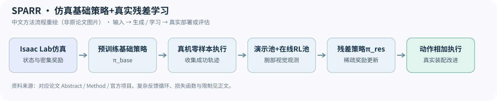
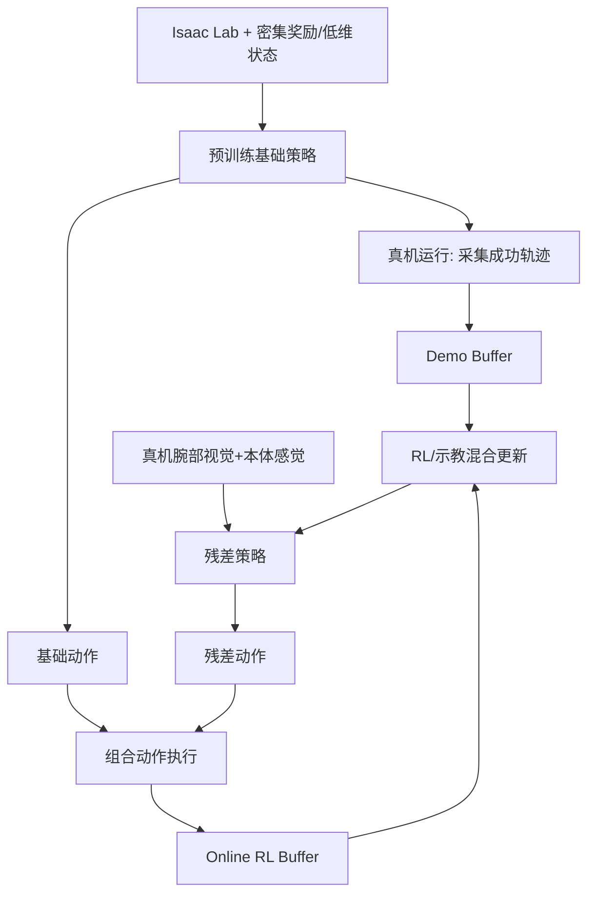
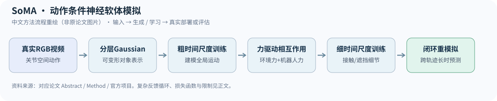
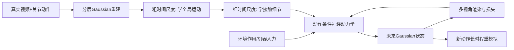
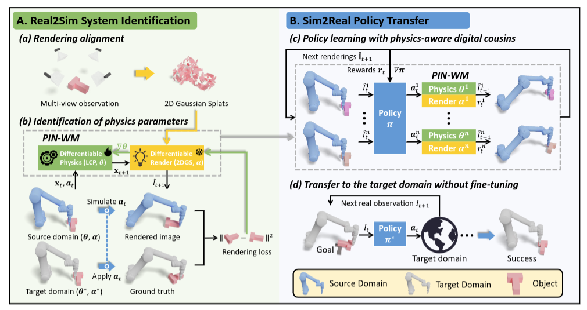
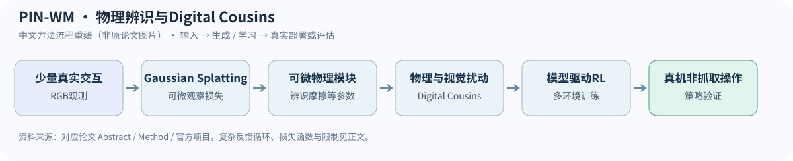
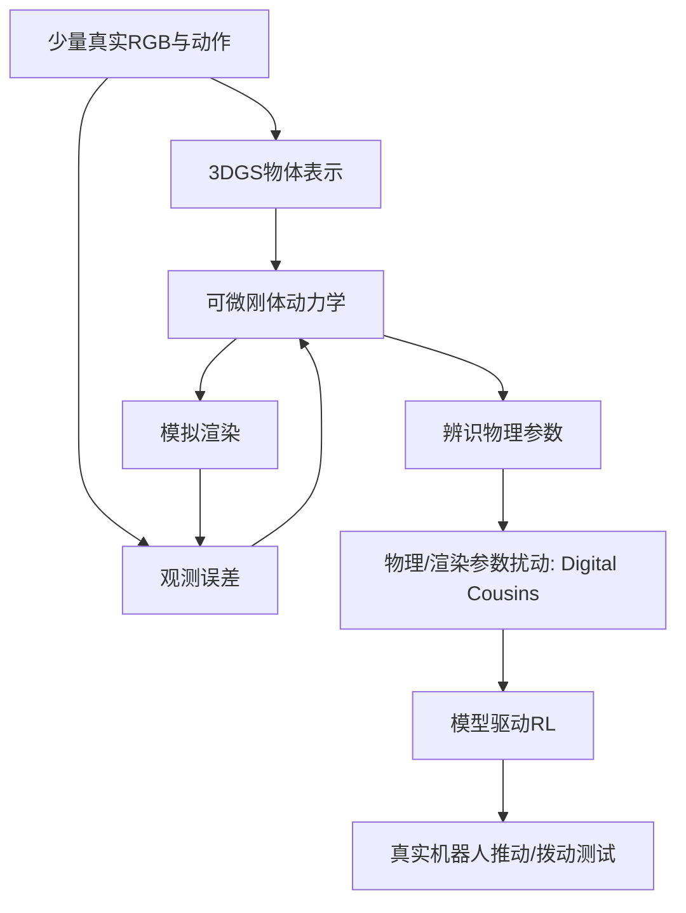

# 3. 物理可靠性：从理想引擎到真机交互校准

“物理可靠性”并不等价于用更昂贵的引擎求解接触方程。至少存在三种不同路径：**训练真实域误差补偿策略**，**直接从真实交互学习物体的神经动力学**，以及**利用少量真实观测辨识可微物理模型再生成参数邻域**。本章按这三类问题组织。

## 3.1 SPARR：真实残差强化学习补偿装配误差

### ① 论文基本信息
- **原题**：SPARR: Simulation-based Policies with Asymmetric Real-world Residuals for Assembly
- **作者/机构**：Yijie Guo 等；NVIDIA Research。
- **发表**：ICRA 2026；[论文](https://arxiv.org/abs/2602.23253)｜[官方项目](https://research.nvidia.com/labs/srl/projects/sparr/)｜[GitHub](https://github.com/NVlabs/SPARR)。

### ② 论文概述（根据原文 Abstract 忠实中文译述）
精密装配要求接触过程中保持非常准确的运动与力学配合。仿真训练虽然可以产生较好的装配策略，部署到现实后仍会因为 Sim-to-Real 差异退化；纯真实机器人强化学习又经常需要人工监督，且环境变化时泛化不足。SPARR 因此将仿真训练的基础策略与真实环境中学习的残差策略结合：前者用低维状态和密集奖励提供初始行为先验，后者使用视觉观测和稀疏奖励纠正真实动力学与传感器误差。作者在多类双部件真实装配中获得接近完全成功的结果；相较当时的零样本 Sim-to-Real 对照，成功率相对提升 38.4%、循环时间相对减少 29.7%，且不要求人工示教或在线人工干预。

### ③ 研究动机与核心问题
直接把仿真策略放到真机，最大的问题是小的接触位置误差在插入/卡扣装配中会被放大；然而从零开始真机 RL 又因稀疏奖励缺乏成功探索。SPARR 的关键假设是：**仿真策略虽不完美，仍能提供足够接近成功的行为和少量真实成功轨迹**，让残差策略在可行区域中学习，而不用从随机动作探索。

### ④ 方法总览与论文主图
- [作者原始 Pipeline Overview（PNG）](https://research.nvidia.com/labs/srl/projects/sparr/assets/overview.png)｜[论文](https://arxiv.org/abs/2602.23253)。
- 原图分为三段：(a) 仿真预训练基础策略；(b) 在真机上执行基础策略并筛选成功 Rollout；(c) 用 Demo Buffer 和 Online RL Buffer 训练残差策略。执行动作是基础策略输出与残差动作的组合。

### ⑤ 核心技术与算法细节
**步骤一，训练具备强先验的基础策略。** 作者在 Isaac Lab 中用低维机器人/物体状态及密集奖励预训练特定装配任务策略。相比仅由 RGB 决策，基础策略利用仿真可获得的低维状态更容易形成稳定的装配基本动作。

**步骤二，在真机零样本执行并自动建立示教池。** 将基础策略移植到真实机器人；即便成功率尚不理想，它通常能完成一部分装配。系统把真实成功执行写入示教池，作为后续 RL 探索和行为学习的正向信号，而不是要求人类专门遥操作采集示教。

**步骤三，引入非对称的观察与奖励机制。** 残差策略使用真实视觉/本体感觉，学习校正仿真策略感知不到的偏差；训练采用真实环境稀疏任务奖励。这里“非对称”体现在两级策略所观察的输入和训练方式不同，而不是要求真实环境复现仿真中的全部特权状态。

**步骤四，动作组合和在线回流。** 执行阶段可以概括为 $a_t=a_t^{\mathrm{base}}+\Delta a_t^{\mathrm{real}}$。新产生的在线轨迹进入 RL 缓冲区，成功且高质量的轨迹还可加入示教缓冲区，形成以成功先验为锚点的再训练闭环。该公式是算法层面的简化写法，具体残差尺度、动作参数化应以源码及论文为准。

**安全性前提。** 真机 RL 仍然需要限制动作范围、考虑碰撞与安全停机；“无需人工监督”不等于适合任意高风险装配现场。

### ⑥ 完整 Pipeline（中文重绘）

### ⑦ 实验设计与主要结果
作者从 AutoMate 的 100 项装配任务中选取仿真成功率超过 99% 的 10 项开展真机实验，并比较 SERL、AutoMate 零样本策略与 SPARR。SPARR 在该组真实任务中达到 95%–100% 成功率，部分评估每任务 20 次试验；论文也考察了迁移到不在基础策略预训练范围内的 NIST 任务的适应表现。必须强调：**95%–100% 是真实残差学习完成后的性能，不是基础策略的零样本性能**。

### ⑧ 方法特点与局限性
**特点**：直接以真实反馈修正物理/感知误差；避免为每类摩擦或装配公差重新标定整个模拟器；从基础策略自动挖掘示教降低人工成本。**局限**：依赖零样本策略已经能够在真实环境偶尔成功；仍需安全的真实探索预算；已验证场景主要是刚体精密装配，不能直接覆盖柔性材料、多步骤厨房操作等任务。

---

## 3.2 SoMA：动作条件神经软体动力学模拟

### ① 论文基本信息
- **原题**：SoMA: A Real-to-Sim Neural Simulator for Robotic Soft-Body Manipulation
- **作者/机构**：Mu Huang 等；复旦大学、上海人工智能实验室、上海交通大学、香港中文大学、香港大学。
- **发表**：ICML 2026；[正式论文](https://proceedings.mlr.press/v306/huang26bh.html)｜[官方项目](https://city-super.github.io/SoMA/)｜[GitHub](https://github.com/Wrioste/SoMA)。

### ② 论文概述（根据原文 Abstract 忠实中文译述）
在机器人与柔性物体频繁交互时，物体形变同时受到环境作用和机器人动作驱动，准确模拟非常困难。现有系统依赖预先定义的物理规律，或者采用未明确条件化于机器人控制的数据驱动动力学，因此在精度、稳定性及泛化性上受限。SoMA 提出基于 3D Gaussian Splatting 的软体操作模拟器：在统一神经潜空间中联合建模可变形动力学、环境力和机器人关节动作，实现端到端 Real-to-Sim。通过在学习得到的高斯表示上处理交互，它能够在不依赖预先设置的具体物理模型时支持可控、长时程的软体操作模拟，并对训练轨迹之外的交互泛化。作者报告真实操作重模拟的精度和泛化指标平均改善约 20%，并展示长时程布料折叠等复杂过程。

### ③ 研究动机与核心问题
布料、线缆、毛绒玩具等软体具有大量连续自由度；用刚体关节模型描述并不自然，对真实材质的弹性参数、接触摩擦进行系统辨识也很困难。仅把视觉视频拟合得漂亮，不能预测机器人执行新动作后柔性物体会怎样变化。SoMA 的核心是**将动作条件和作用力机制直接写入学习式变形动力学**。

### ④ 方法总览与论文主图
- [作者原始 SoMA Framework（PNG）](https://city-super.github.io/SoMA/imgs_png/framework.png)｜[论文](https://proceedings.mlr.press/v306/huang26bh.html)。
- 原图左边是真实多视角采集，中间分层高斯与不同时间步长的训练流程，右边是机器人与环境作用力对形变控制的机制。图的重点是粗—细两阶段训练和力驱动的状态推进。

### ⑤ 核心技术与算法细节
**步骤一，采集动作可追溯的真实视频。** 输入包括真实 RGB 观测及机器人关节空间动作（而非只有物体轨迹或无动作的视频）；多视角信息提供了对物体三维形变的观察约束。

**步骤二，分层高斯表示。** 使用可渲染的 Gaussian Splats 表示软体对象，对粒度不同的结构进行层级组织。与直接在像素空间做黑箱视频生成相比，这种表示保留了连续三维状态与跨视角投影的一致性。

**步骤三，学习力驱动的状态演化。** 网络在潜空间中结合机器人施加的交互、环境影响与物体已有变形，预测高斯点的下一步运动和形态。它并非声称恢复真实物体的全部材料参数，而是追求动作条件下可控的重模拟能力。

**步骤四，粗到细的两阶段训练。** 第一阶段用较大的帧间隔学习全局运动与长期趋势；第二阶段减小帧间隔，在接触、遮挡等复杂局部条件下优化细节。图像重建与动力学约束共同作用于训练，使模型既能还原视频，也能够被新动作驱动。

**步骤五，测试长时程/未见动作。** 给定不同的机器人动作序列，让模型预测物体随时间的形变；评价不仅要看某一帧的 PSNR/深度误差，还要看长时间累积误差和对未见接触方式的反应。

### ⑥ 完整 Pipeline（中文重绘）

### ⑦ 实验设计与主要结果
论文对布料、绳索与体积型柔性物体进行真实数据重模拟与泛化评估，比较 PhysTwin、GausSim 等方法，并检查不同视角的一致性。作者报告相对基线平均约 20% 的精度和泛化改善。**此处是模拟/重模拟指标，不能把 20% 直接写成真实机器人策略成功率提升**；因此将它定位为“物理/神经模拟能力”而非完整策略迁移算法更准确。

### ⑧ 方法特点与局限性
**特点**：不要求把柔性物体简化成固定刚体；能处理机器人动作条件、三维可渲染表示和长时形变。**局限**：真实视频数据、相机标定和训练成本仍不低；接触力未必唯一可辨识；视觉重模拟效果与“真实控制闭环一定成功”之间仍存在验证距离。

---

## 3.3 PIN-WM：从真实视觉辨识物理模型，再生成 Digital Cousins

### ① 论文基本信息
- **原题**：PIN-WM: Learning Physics-INformed World Models for Non-Prehensile Manipulation
- **作者/机构**：Wenxuan Li 等；国防科技大学、武汉大学、深圳大学等。
- **发表**：RSS 2025；[正式论文](https://roboticsproceedings.org/rss21/p153.html)｜[arXiv](https://arxiv.org/abs/2504.16693)｜[官网](https://pinwm.github.io/)｜[GitHub](https://github.com/XuAdventurer/PIN-WM)。

### ② 论文概述（根据原文 Abstract 忠实中文译述）
推动、拨动物体等非抓取操作高度依赖摩擦和恢复系数等复杂物理交互，学习具备泛化能力的策略十分困难。作者采用模型驱动强化学习，提出用于三维刚体运动的 Physics-INformed World Model（PIN-WM），目标是根据视觉观测高效辨识动力学系统。该方法以可微物理仿真为基础，只需少量、与目标任务无关的真实交互轨迹；同时通过 Gaussian Splatting 产生的观测损失训练，无需精确的外部状态估计。为缩小 Sim-to-Real 差异，作者围绕辨识好的模型扰动物理和渲染参数，建立多个 Digital Cousins。仿真和真实机器人实验显示，该组合能够帮助学习更鲁棒的非抓取操作技能，优于论文中比较的 Real2Sim2Real 方法。

### ③ 研究动机与核心问题
非抓取操作的结果取决于摩擦、惯性、碰撞和反弹；手工随机给定这些参数可能生成大量根本不对应真实任务的物理世界。PIN-WM 的问题是：能否先从少量真实交互中恢复一个**可解释、可微调的三维刚体动力学模型**，再围绕真实参数附近的合理变化训练策略？

### ④ 方法总览与论文主图
- [作者原始方法图（官方 PNG，原文件名 pipline.png）](https://pinwm.github.io/static/images/pipline.png)｜[RSS 正式论文](https://roboticsproceedings.org/rss21/p153.html)。
- 原图主要展示视觉重建、可微物理辨识、形成物理数字近邻，以及在这些模型上通过 RL 学习操作策略的连续流程。注意数字近邻不是重新采集多组真实实验，而是从已经辨识的模型中产生变化。

*作者原始图源：[点击核对](https://pinwm.github.io/static/images/pipline.png)；论文主图/展示图与下方中文重绘图已明确区分。*

### ⑤ 核心技术与算法细节
**步骤一，真实视觉交互与可渲染状态。** 用少量推动/拨动物体的真实轨迹提供图像序列和机器人动作；通过 3DGS 构建能从不同视角投影的物体外观，以渲染误差为动力学辨识提供监督，减少对真实物体状态逐帧人工标注的依赖。

**步骤二，物理模型参数辨识。** 在显式刚体运动结构上使用可微物理求解，反向调整影响接触过程的参数（如摩擦、恢复性质等），使模拟运动渲染出的图像尽量与真实观测一致。网络学习的不是任意视频幻觉，而是受三维物理模型约束的运动。

**步骤三，构造 Digital Cousins。** 以辨识模型为中心，在物理参数与渲染参数空间做结构化扰动，形成一簇彼此不同但与真实操作机制相关的模拟环境。这能缓解参数无法被少量观测完全唯一确定的问题。

**步骤四，模型驱动强化学习。** 在一组数字近邻中生成运动轨迹并学习推动策略，使策略不依赖某一个估计参数的精确数值。最后部署到真实机器人评价新对象或物理扰动下的稳定性。

**损失与可辨识边界。** 可概括为最小化模拟渲染与真实图像的观测误差，并结合物理演化约束；具体权重和求导形式需要以论文公式为准。视觉对齐有时存在多个等价物理解释，这正是保留 Digital Cousins 的原因之一。

### ⑥ 完整 Pipeline（中文重绘）

### ⑦ 实验设计与主要结果
论文在仿真和真实机器人上的非抓取操作任务评估模型和迁移策略，重点与其他 Real-to-Sim-to-Real 方法比较。论文摘要未给出可跨任务直接使用的单一真实成功率，因此文档不虚构统一数字。应分别关注：少量交互辨识需求、可微物理精度、数字近邻策略泛化和真实推动成功率。

### ⑧ 方法特点与局限性
**特点**：物理参数具有一定结构和解释性；学习依赖少量真实交互，且通过图像损失避免强状态标注；数字近邻把模型不确定性转为训练覆盖。**局限**：主要面向三维刚体推动/拨动，不是任意接触和柔性物体的通用模拟器；对遮挡严重、接触复杂的场景，辨识可能多解或出现明显估计误差。

---

## 3.4 物理路线对比与工程基础设施补充

| 工作 | 主要学习对象 | 真实交互起到什么作用 | 优先适用任务 |
|---|---|---|---|
| SPARR | 真实域**动作残差策略** | 在线 RL 的稀疏成功奖励与示教回流 | 刚体精密插入/装配 |
| SoMA | 柔性物体的**动作条件神经动力学** | 拟合真实交互与变形 | 布料、绳索、软体 |
| PIN-WM | **可微刚体参数+物理数字近邻** | 对物理参数进行视觉辨识 | 推动、拨动、非抓取接触 |

**Newton（NVIDIA / Google DeepMind / Disney Research）**是应持续关注的可微多物理场工程基础设施：[GitHub](https://github.com/newton-physics/newton)。它可以支持更高效的仿真、接触与梯度计算，但不应把“可微引擎的存在”直接当作真实机器人迁移算法的结果。以上三篇分别优化策略、神经模拟器、物理辨识，不能用同一个成功率排序替代技术比较。
