# 4. 轨迹多样性：从扰动已有轨迹到主动构造有价值的行为数据

轨迹多样性至少包含**初始状态、物体与场景、机器人运动方式、动作结果、任务/指令语义**五个层次。同一轨迹变换出大量不同纹理的视频，只扩展视觉域，不一定增加动作分布覆盖；生成多个专家程序可以增加任务和运动差异，但自动专家也可能偏向短、平滑、近乎总是成功的轨迹。因此还必须讨论轨迹质量、冗余和后续真实任务增益。

## 4.1 RoboTwin 2.0：MLLM 专家程序生成与仿真闭环验证

### ① 论文基本信息
- **原题**：RoboTwin 2.0: A Scalable Data Generator and Benchmark with Strong Domain Randomization for Robust Bimanual Robotic Manipulation
- **作者/机构**：Tianxing Chen 等；上海交通大学、上海人工智能实验室、香港大学等。
- **发表**：ICML 2026；[正式论文](https://proceedings.mlr.press/v306/chen26j.html)｜[项目](https://robotwin-platform.github.io/)｜[GitHub](https://github.com/RoboTwin-Platform/RoboTwin)。

### ② 论文概述（根据原文 Abstract 忠实中文译述）
通过仿真合成数据增强真实操作已成为重要路径，但现有合成数据在复杂双臂任务中面临两类问题：专家动作在协同任务里失败后缺少自动纠错机制，以及跨场景泛化所需的视觉与空间变化仍不足。RoboTwin 2.0 因此提出面向双臂操作的大规模、闭环和自动化数据生成与统一评估框架。系统基于 RoboTwin-OD 资产库（147 类、731 个实例），将多模态大模型与仿真执行校验结合，建立能提升专家程序生成成功率的自动反馈循环。同时沿杂物干扰、光照、背景、桌面高度、语言指令五个维度进行结构化域随机化。作者实现了覆盖五种本体、50 个双臂任务的环境；合成数据预训练后，VLA 在特定真机实验中相对 10 条示教少样本基线提升至 3.6 倍，零样本泛化相对对照达到 2.2 倍。作者公开了数据生成器、基准、预采集数据及相关代码。

### ③ 研究动机与核心问题
复杂双臂任务的成本瓶颈，不只是“示教数据条数少”，而是**为每个任务写一个稳健可执行专家程序耗费大量人工**。当物体位置或双手协作时序变化，脚本专家往往失败。RoboTwin 2.0 将专家程序本身变成可由 MLLM 生成、在模拟器运行、再通过失败反馈修改的对象，从而扩展任务和初始状态覆盖。

### ④ 方法总览与原论文截图

下列图片均是从[原论文 PDF](https://raw.githubusercontent.com/mlresearch/v306/main/assets/chen26j/chen26j.pdf)直接裁切的**原始论文图**，已保存于本仓库，非 AI 生成或重新绘制。引用时请注明论文 Figure 编号。

**主图｜Figure 1：自动化双臂操作数据生产平台**

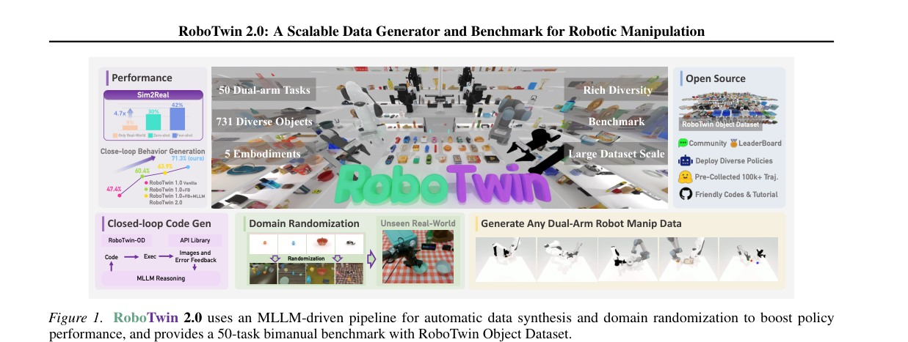

*原论文 Figure 1，PDF 第 2 页。[查看原文对应页](https://raw.githubusercontent.com/mlresearch/v306/main/assets/chen26j/chen26j.pdf#page=2)。*

**方法/架构图｜Figure 2：Code Agent 专家生成与仿真反馈纠错 Pipeline**

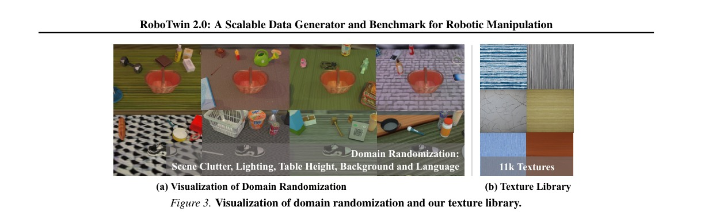

*原论文 Figure 2，PDF 第 4 页。[查看原文对应页](https://raw.githubusercontent.com/mlresearch/v306/main/assets/chen26j/chen26j.pdf#page=4)。*

**读图重点：** 主图展示任务和资产规模；方法图则详细展示 Code Agent 编写、模拟器验证和程序迭代闭环。

*图号、原论文 URL 及 PDF 截取坐标记录在 [截图来源清单](../../assets/paper-screenshots/manifest.json)。详细中文 Pipeline 见下一节。*

### ⑤ 核心技术与算法细节
**步骤一，资产与任务定义。** 基础资产库 RoboTwin-OD 提供丰富类别实例与语义信息；配置任务初态、参与对象、双臂本体和目标成功条件。对象变化不等于动作自动可行，专家程序仍需在新初态下被检查。

**步骤二，MLLM 辅助专家程序生成。** 模型综合文本任务、场景元素和可用机器人 API，编写能被模拟器调用的专家逻辑；复杂协作涉及双手先后动作、物体交接、相互避让与目标条件，不适合纯轨迹坐标扰动完成。

**步骤三，Simulation-in-the-Loop。** 在可执行仿真中运行程序，根据执行错误与任务是否达成，把失败信息反馈到程序修改过程；程序迭代至满足约束后才作为数据收集专家。这个机制的实质是**用执行反馈检验符号/程序生成，而不是相信 MLLM 的文本输出**。

**步骤四，结构化扰动与批量生产。** 对杂物干扰、光照、背景、台面高度、语言指令等五轴变化进行组合，配合位置与对象设定产生大量不同观测和操作条件，保存机器人状态、动作、相机数据与完成标志。

**步骤五，策略训练与跨域评估。** 使用合成数据预训练 VLA，按统一任务及真实设置比较零样本和少样本迁移；注意专家纠错、数据规模、环境随机化彼此耦合，单一成功率不能识别每个组件的贡献。

### ⑥ 完整 Pipeline（中文重绘）
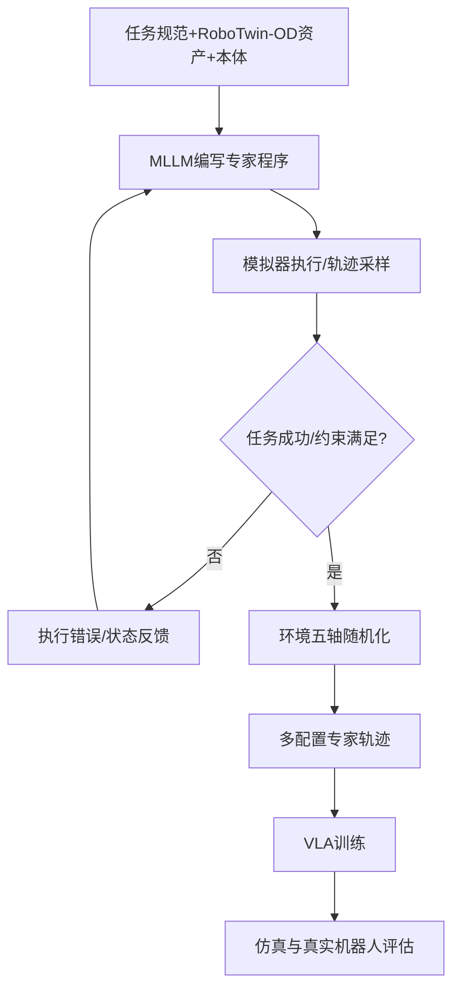

### ⑦ 实验设计与主要结果
论文部署 50 个双臂任务、五种本体，资产库包含 731 个实例 / 147 类。作者报告在特定真机对照中，模拟预训练的 VLA 少样本表现为相应 10-demo 基线的 3.6×，零样本表现为对应基线的 2.2×。这里是**相对比值**，而非 3.6 倍的绝对成功率；并不能把所有收益只归因于 MLLM 程序生成。

### ⑧ 方法特点与局限性
**特点**：主动生成新的可执行专家，拓展到双臂协作；程序可被仿真明确验证；物体/语言/环境变化丰富。**局限**：如果模拟器的成功判定或接触模型不准确，自动专家仍可能利用虚假的物理可行性；高质量任务程序也不能自动覆盖失败恢复、长尾状态与真实任务中的人工策略多样性。

---

## 4.2 RoboDream：运动锚定的组合式生成式机器人数据

### ① 论文基本信息
- **原题**：RoboDream: Compositional World Models for Scalable Robot Data Synthesis
- **作者/机构**：Junjie Ye 等；USC Physical Superintelligence Lab、Toyota Research Institute 等。
- **状态**：2026 年 arXiv；作者仓库标注 IROS 2026；[论文](https://arxiv.org/abs/2606.02577)｜[项目](https://junjieye.com/RoboDream/)｜[GitHub](https://github.com/Jay-Ye/RoboDream)。

### ② 论文概述（根据原文 Abstract 忠实中文译述）
机器人学习需要大规模多样化示教，但通过真实遥操作收集成本极高。视频扩散模型看似适合扩增数据，却常停留于外观变化，或凭空生成不符合机器人本体约束的动作。RoboDream 提出以机器人本体为中心的组合式世界模型，能够在新物体、新场景和新视角下合成真实感操作示教。方法以已渲染的机器人运动为锚点，并显式引入场景与物体先验，将动作轨迹执行与环境合成分开。这支持两类新能力：Retrieval and Rebirth，即把已有动作放入新的场景上下文；Prop-Free Teleoperation，即操作者先在没有实物的情况下操控机器人，再由生成模型补出目标物体及环境，从而减少摆放与复位时间。作者通过真实机器人实验发现生成数据能提升后续策略性能，并减少真实示教需求。

### ③ 研究动机与核心问题
对扩散模型直接输入“机器人拿起某物”的文本，可能生成与真实机器人关节/夹爪运动不一致的视频。RoboDream 的关键是将**已经存在的机器人轨迹视为硬约束或强先验**，让生成模型改变对象和场景的视觉呈现，从而尽量保留动作配对关系。

### ④ 方法总览与原论文截图

下列图片均是从[原论文 PDF](https://arxiv.org/pdf/2606.02577)直接裁切的**原始论文图**，已保存于本仓库，非 AI 生成或重新绘制。引用时请注明论文 Figure 编号。

**主图｜Figure 1：组合式世界模型扩增机器人示教**

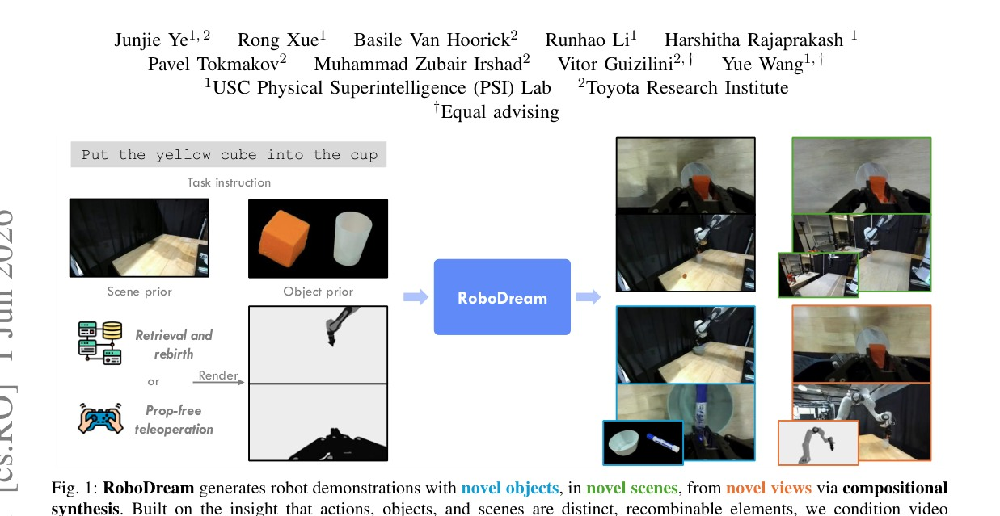

*原论文 Figure 1，PDF 第 1 页。[查看原文对应页](https://arxiv.org/pdf/2606.02577#page=1)。*

**方法/架构图｜Figure 2：运动条件与场景/物体先验融合架构**

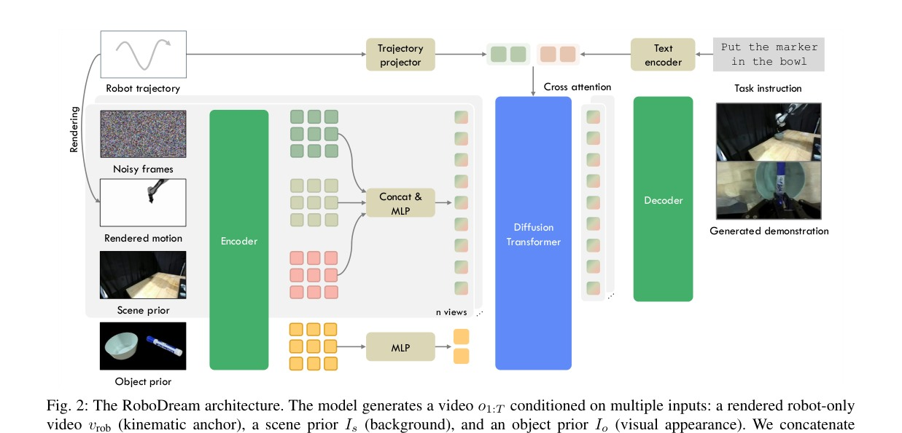

*原论文 Figure 2，PDF 第 3 页。[查看原文对应页](https://arxiv.org/pdf/2606.02577#page=3)。*

**读图重点：** 总览展示跨物体、场景和视角生成；架构图展示本体运动和多种视觉先验进入视频模型。

*图号、原论文 URL 及 PDF 截取坐标记录在 [截图来源清单](../../assets/paper-screenshots/manifest.json)。详细中文 Pipeline 见下一节。*

### ⑤ 核心技术与算法细节
**步骤一，获得可追溯运动。** 可从既有机器人数据中检索轨迹，也可从 prop-free teleoperation 中获取机械臂/末端执行器运动。与凭空生成整个动作序列不同，这些轨迹先确定机器人的可实现运动。

**步骤二，机器人运动条件渲染。** 在模拟器中渲染只有机器人本体的运动视频，保持机体运动和摄像机视角对应；同时准备场景、对象及文字任务先验，约束“新物体被放在什么环境、如何与原动作相配”。

**步骤三，组合式视频生成。** 生成模型把机器人运动视频、对象和场景先验及任务语义组合成新的高真实感示教。其可变因素包括新物体实例、不同背景、变化视角和相同运动下的任务上下文；任务动作并非由生成模型从零规划。

**步骤四，两条实际数据生产方式。** Retrieval and Rebirth 利用历史机器人轨迹配对新场景；Prop-Free Teleoperation 减少每次真实放置物体/恢复环境的时间。对于后者，物体是否真的沿着手的运动发生符合物理的接触，仍要通过检查，而不能仅凭合成视频的视觉合理性判断。

**步骤五，策略消费与部署。** 合成视频对齐原机器人轨迹/动作，并送入下游视觉策略或 VLA 训练，之后在真机执行以检验新增数据是否有用。作者仓库目前提供生成推理/演示与相关模块，开源范围随版本更新，应按当前 README 检查。

### ⑥ 完整 Pipeline（中文重绘）
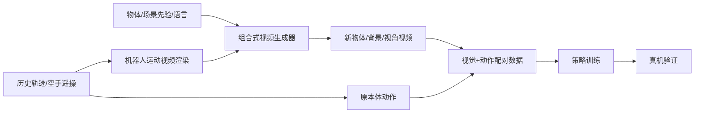

### ⑦ 实验设计与主要结果
论文报告在多类真实操作任务上，合成数据能改善下游策略训练效果并减少真实样本需求。摘要没有给出可作为统一排名的单一成功率，因此本综述不臆造一个百分比。评估该路线时优先看：同一轨迹跨对象与跨背景产生的有效多样性、动作标签对齐程度、是否覆盖未见条件，以及真实策略的提升幅度。

### ⑧ 方法特点与局限性
**特点**：把机器人运动可实现性与视觉数据扩增分离；能够减少真实环境复位成本；适合已有大规模动作数据二次利用。**局限**：新对象与原轨迹是否具有真实接触相容性无法仅由渲染保证；合成物体可能出现几何穿透、因果关系错误；更换本体/操作时仍需模型与任务匹配。

---

## 4.3 Real2Render2Real：不运行完整动力学也能规模化示教

### ① 论文基本信息
- **原题**：Real2Render2Real: Scaling Robot Data Without Dynamics Simulation or Robot Hardware
- **作者/机构**：Justin Yu 等；UC Berkeley、Toyota Research Institute 等。
- **发表**：CoRL 2025；[正式论文](https://proceedings.mlr.press/v305/yu25a.html)｜[项目](https://real2render2real.com/)｜[GitHub](https://github.com/uynitsuj/real2render2real)。

### ② 论文概述（根据原文 Abstract 忠实中文译述）
扩展机器人学习需要庞大且多样的示教，当前的人工遥操作方式费时昂贵，还依赖实体机器人。Real2Render2Real 提出无需对象动力学仿真、也无需使用机器人硬件遥操作的数据生产方案。输入只有手机拍摄的一组物体扫描图像和一段人类示范视频；系统恢复细致的三维对象几何与外观、追踪六自由度对象运动，从而渲染大量高视觉质量、与特定机器人本体无关的示教。它利用 3D Gaussian Splatting 构造刚体及关节物体资产，进一步转换为 Mesh 以兼容 Isaac Lab 等并行渲染环境，但关闭碰撞建模。合成的图像/本体状态/动作数据可被 VLA 和模仿学习策略使用。作者的实体机器人实验表明，单条人类示教衍生的数据可以达到约 150 条机器人遥操作示教训练模型的相近表现。

### ③ 研究动机与核心问题
大量物体摆放、抓放类演示的核心监督可能是**物体位姿随时间变化、以及机器人应该如何跟随这个目标**。如果只为生成训练数据而强制运行复杂接触求解器，成本很高。R2R2R 有意将“动作运动学合理”和“需要完整动力学模拟”拆开，从一条真实人类示范重建目标运动，再反推机器人运动。

### ④ 方法总览与原论文截图

下列图片均是从[原论文 PDF](https://raw.githubusercontent.com/mlresearch/v305/main/assets/yu25a/yu25a.pdf)直接裁切的**原始论文图**，已保存于本仓库，非 AI 生成或重新绘制。引用时请注明论文 Figure 编号。

**主图｜Figure 1：从手机扫描到机器人训练数据的完整流程**

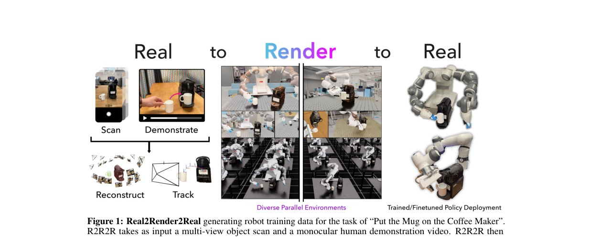

*原论文 Figure 1，PDF 第 2 页。[查看原文对应页](https://raw.githubusercontent.com/mlresearch/v305/main/assets/yu25a/yu25a.pdf#page=2)。*

**第二张关键实验图｜Figure 2：数据生成效率与真实策略效果（关键实验图）**

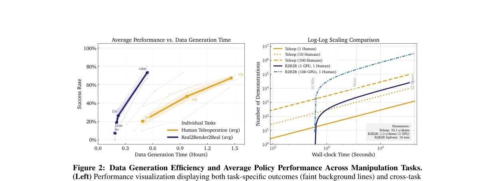

*原论文 Figure 2，PDF 第 3 页。[查看原文对应页](https://raw.githubusercontent.com/mlresearch/v305/main/assets/yu25a/yu25a.pdf#page=3)。*

**读图重点：** Figure 1 已展示数据生产的主要步骤；Figure 2 是性能与效率对照，并非第二张架构图。

*图号、原论文 URL 及 PDF 截取坐标记录在 [截图来源清单](../../assets/paper-screenshots/manifest.json)。详细中文 Pipeline 见下一节。*

### ⑤ 核心技术与算法细节
**步骤一，从真实世界提取资产和目标动作。** 手机扫描对象以恢复 3D 几何/外观；从单条人类视频估计物体随时间的六自由度运动。对于可动部件，需保留对象整体与局部运动关系。

**步骤二，视觉表示和渲染资产转换。** 3DGS 用于灵活重建外观与对象结构；必要时转换为可导入模拟环境的 Mesh。引入几何资产主要用于画面渲染/可见性，而非为了完整求解真实接触。

**步骤三，运动学机器人轨迹生成。** 从对象目标运动及抓取/操作关系构造机器人的目标位姿序列，再利用逆运动学获得关节轨迹。需要处理运动学可达性与机器人配置，但**不调用完整对象动力学或真实碰撞闭环**。

**步骤四，并行合成数据。** 在 Isaac Lab 等高吞吐渲染环境中变更初始物体摆位、摄像机/场景条件，把一个人类示范变成大量可配对机器人动作与图像的示教片段。

**步骤五，策略训练与真实验证。** 使用合成数据训练能消费 RGB 和机器人本体状态的策略。结果证明对部分任务这种低成本监督足以有效，但不能据此认为“物理引擎对所有机器人操作都可省略”。

### ⑥ 完整 Pipeline（中文重绘）
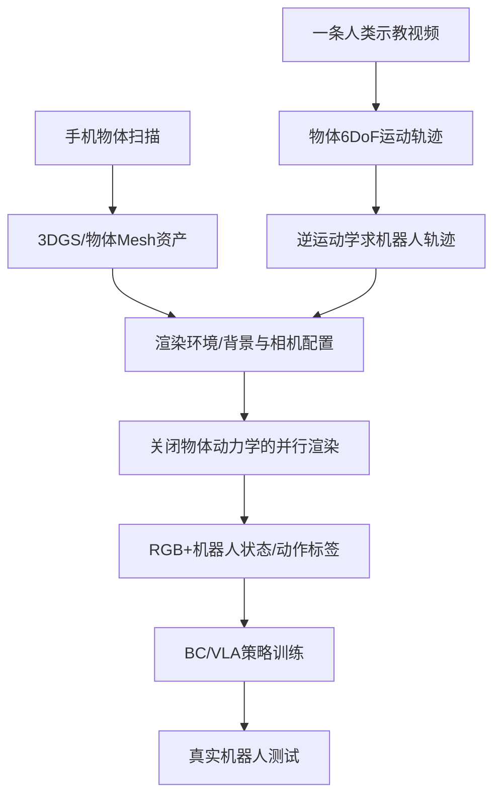

### ⑦ 实验设计与主要结果
CoRL 正式论文报告，在论文测试的真实操作场景中，一条人类示教生成的数据训练得到的策略可以接近使用 150 条机器人遥操作示教训练的策略。这个结论与“1 条演示在任意任务等价于 150 条”不同；必须附带资产重建、适用任务以及运动学结构的限制。

### ⑧ 方法特点与局限性
**特点**：对部分任务极具数据效率，不要求实体机器人遥操作与完整动力学；物体运动来自现实示范，监督目标明确。**局限**：面对插入、公差装配、强摩擦与复杂碰撞时，IK 合理不意味着物理可执行；可能存在没有显式建模的抓持稳定性与物体相互穿透。

---

## 4.4 SCIZOR：从“更多示教”转向状态—动作级数据筛选

### ① 论文基本信息
- **原题**：SCIZOR: A Self-Supervised Approach to Data Curation for Large-Scale Imitation Learning
- **作者/机构**：Yu Zhang 等；UT Austin、NVIDIA。
- **发表**：ICRA 2026（Oral）；[官方论文链接](https://ut-austin-rpl.github.io/SCIZOR/)｜[GitHub](https://github.com/UT-Austin-RPL/SCIZOR)。

### ② 论文概述（根据原文 Abstract 忠实中文译述）
模仿学习可以从大量人类演示中学习不同机器人行为，但大规模数据经常混合质量参差的动作，反而削弱策略训练。既有数据整理方法要么需要昂贵人工标签，要么仅在数据集/整条轨迹级别筛选，忽略了单个状态—动作样本的质量。SCIZOR 提出一种自监督、细粒度的数据筛选框架，移除两类低价值样本：一类是没有任务进展的次优转移，另一类是反复出现、信息冗余的转移。前者利用自监督任务进度预测，后者利用状态—动作联合表示去重。实验表明，减少数据量之后，模仿学习策略仍能取得更好的性能，在多个基准上平均提升约 15.4%。

### ③ 研究动机与核心问题
同一长轨迹中可能同时包含关键操作、停顿、无效动作和完全重复的靠近过程。整条轨迹“一刀切”地保留或删除会损失有效部分。SCIZOR 的目标是让**监督数据的训练效用，而不是示教数量**成为优化对象；这属于“轨迹有效多样性”的数据策展路线。

### ④ 方法总览与原论文截图

下列图片均是从[原论文 PDF](https://arxiv.org/pdf/2505.22626)直接裁切的**原始论文图**，已保存于本仓库，非 AI 生成或重新绘制。引用时请注明论文 Figure 编号。

**主图｜Figure 1：次优和冗余转移筛选的整体过程**

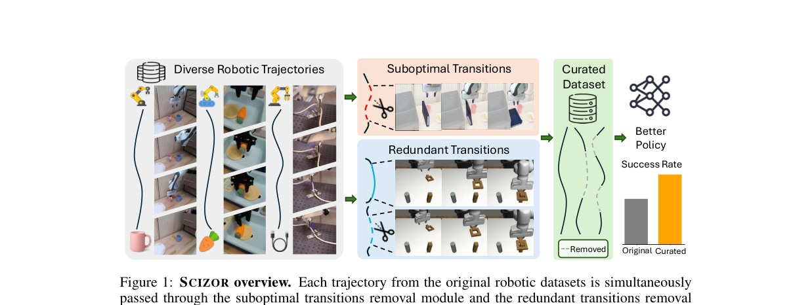

*原论文 Figure 1，PDF 第 2 页。[查看原文对应页](https://arxiv.org/pdf/2505.22626#page=2)。*

**方法/架构图｜Figure 2：任务进度模型和联合状态动作去重框架**

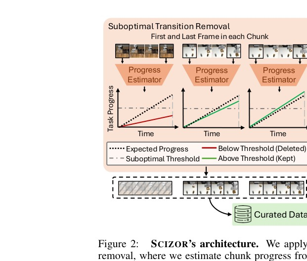

*原论文 Figure 2，PDF 第 4 页。[查看原文对应页](https://arxiv.org/pdf/2505.22626#page=4)。*

**读图重点：** Figure 1 说明筛选数据的目标；Figure 2 展示任务进度评价和聚类去冗余两个分支。

*图号、原论文 URL 及 PDF 截取坐标记录在 [截图来源清单](../../assets/paper-screenshots/manifest.json)。详细中文 Pipeline 见下一节。*

### ⑤ 核心技术与算法细节
**步骤一，统一状态—动作样本单元。** 从示教序列中取得观测、动作和连续时间片段，支持在整条轨迹内部做细粒度判断，而不是为每条 Episode 打单一好坏标签。

**步骤二，自监督任务进度预测。** 训练进度估计器，判断短时间窗口内的状态是否朝任务终点推进。当经过较长时间却几乎没有任务进展时，识别可能的停顿或偏离行为。这不要求手工提供每个动作的 reward，但依赖任务进度代理确实学得有意义。

**步骤三，状态—动作联合表示去冗余。** 把视觉状态与机器人动作编码为同一特征，结合聚类/相似性计算，降低高度重复片段的采样权重或删除部分重复样本。只看图像相似度会误把“同画面但不同动作”的数据判为冗余，因此联合动作表征很重要。

**步骤四，训练策略与验证。** 对比完整数据集、均匀采样减少数据、只剔次优、只去冗余、两者联合的模仿学习表现。合理筛选应在不损失关键多样性的前提下提升有效信息密度。

**重要适用边界。** 这项方法主要服务于学习**成功行为的模仿策略**；对于学习环境状态转移、错误诊断和失败预测的模型，“没有成功完成任务”不一定等于应被删除。

### ⑥ 完整 Pipeline（中文重绘）
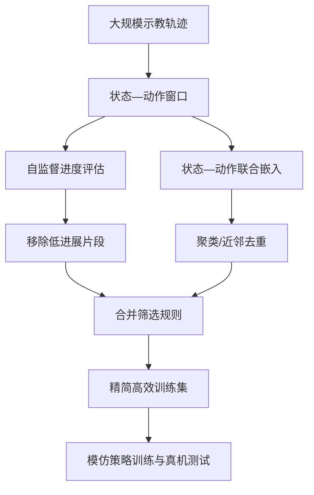

### ⑦ 实验设计与主要结果
官方报告在 RoboMimic、Sirius-Fleet 和 Open-X 等数据设置中，筛选后的模型平均改善约 15.4%；项目页给出不同基准的进一步对照（如 Sirius-Fleet 真机任务上的明显增益）。这里要注意数据筛选率、保留分布及对照训练步数：若不控制这些变量，很容易把“训练更快/数据更少”与“策略本身更强”混为一谈。

### ⑧ 方法特点与局限性
**特点**：低成本、自监督、细粒度处理；不需要生成新视频也能改善训练集质量；能和专家生成系统互补。**局限**：进度代理可能误删必要的等待、回退和安全调整动作；冗余判断对观测编码器敏感；筛选标准必须匹配下游学习目标。

---

## 4.5 轨迹路线横向比较

| 路线 | 新增的多样性从哪里来 | 是否需要可执行物理模拟 | 最主要的约束 |
|---|---|---|---|
| RoboTwin 2.0 | 不同任务、专家程序、本体和环境 | 是，执行验证为核心 | 仿真接触和成功判定的正确性 |
| RoboDream | 相同运动对应更多对象、场景、视角 | 运动锚定与生成结合 | 视频与原动作之间的条件忠实度 |
| Real2Render2Real | 人类对象轨迹+逆运动学+多场景渲染 | 对象动力学关闭 | 运动学合理不保证接触可行 |
| SCIZOR | 删除重复/低价值样本，改善有效覆盖 | 否 | 筛选标准与学习目标一致 |

因此，轨迹研究应区分：`数量扩增`、`可执行专家构建`、`视觉条件扩增`、`有效数据选择`。四种工作解决的不是同一个问题，不能简单用“生成 Episode 数”判断优劣。
