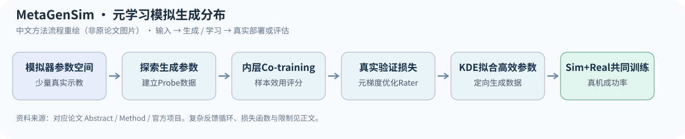
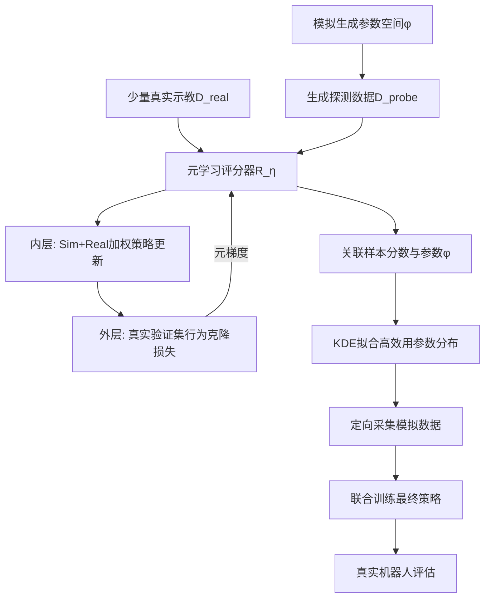
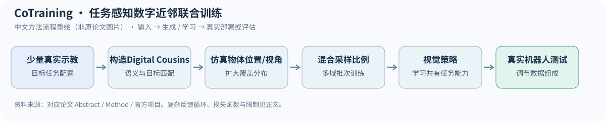
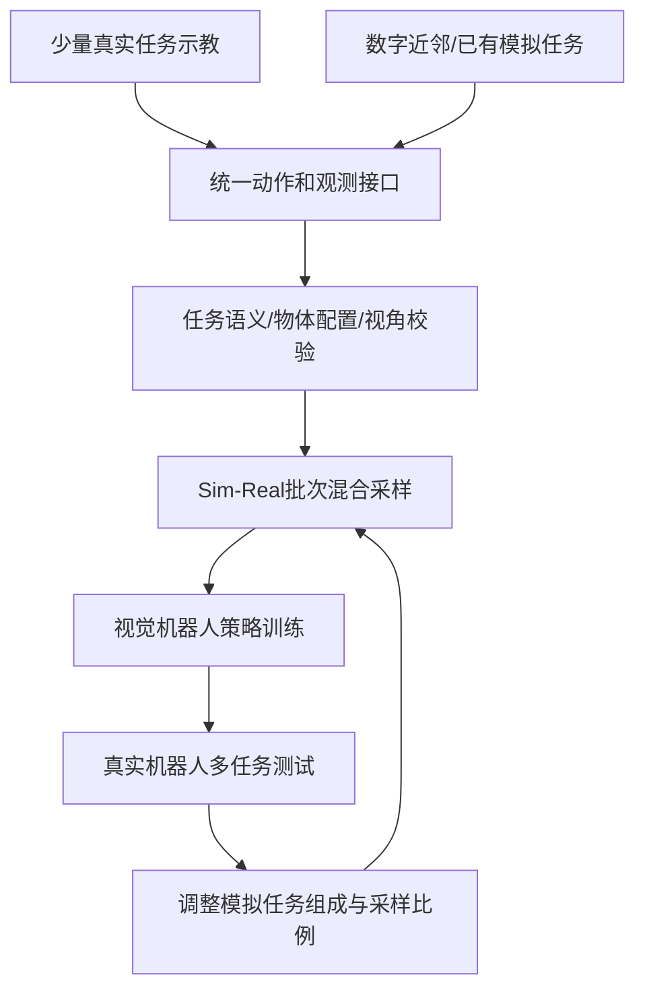

# 5. 真实数据与仿真数据如何协同：配比之外的选择

这是与前三个方向交叉但不相同的问题：即使仿真图像、接触和轨迹都“更好”，训练时如何采样、哪些仿真样本与目标真实任务有关，以及模型是否学到无关的域特征，仍然会造成负迁移。本章分别讨论**主动学习应生成什么数据**与**真实—仿真协同训练的基本机制与实践**。

## 5.1 MetaGenSim：主动优化仿真数据生成分布

### ① 论文基本信息
- **原题**：Active Generative Simulation: Meta-Learning What to Simulate for Sim-and-Real Policy Co-Training
- **作者/机构**：Liqian Ma、Vaibhav Saxena 等；Georgia Institute of Technology。
- **状态**：作者项目页标注 CoRL 2026；[论文](https://arxiv.org/abs/2610.19479)｜[官方项目](https://meta-gensim.github.io/)｜**代码**：截至 2026-11-17，官网仍显示 `Code (coming soon)`，不可将其写为已完整开源。

### ② 论文概述（根据原文 Abstract 忠实中文译述）
真实与仿真联合训练能够用大量模拟数据补充有限真实示教，但过去的方法通常把模拟器当作固定的数据提供者：要么均匀生成，要么从已有数据检索，或依赖专家手动对齐参数。本文提出主动生成式仿真（Active Generative Simulation）：直接优化模拟器生成参数的分布，以最大化后续真实机器人任务表现。MetaGenSim 通过元梯度训练辅助评分网络，在用户给定的参数空间中自动识别高效用的生成条件，而不必由人工制定每项对齐启发规则。仿真与真实任务实验中，该方法优于均匀生成及检索基线；真实任务的完整执行成功率相对于均匀生成提高约 150%，并接近专家手动对齐。作者还展示由轻量代理策略学得的数据分布可以迁移用于 VLA 微调，并能够利用原子技能拼接及物体—容器组合处理模拟与真实任务只有部分匹配的情况。

### ③ 研究动机与核心问题
过去很多研究问“模拟数据与真实数据比例多少最佳”，MetaGenSim 更进一步问：**在固定生成预算下，应该主动生成哪些物体位置、场景配置、技能条件与运动难度，才能最有效提高真实域表现？** 均匀覆盖参数空间并不总有用；过多偏离真实目标任务的样本甚至会导致负迁移。

### ④ 方法总览与论文主图
- [作者原始 Method Figure（官方 PNG）](https://meta-gensim.github.io/static/images/method.png)｜[Algorithm 1 与可交互方法说明](https://meta-gensim.github.io/)。
- 原图三部分：(a) 通过真实验证损失的元梯度训练 Rater；(b) 将样本效用映射到模拟器参数并用 KDE 构建参数效用分布；(c) 从该分布抽样生成新数据并 Sim-Real Co-train。

### ⑤ 核心技术与算法细节
**步骤一，定义可控的生成参数空间。** 用户指定模拟器可调的参数 (phi)，例如物体位置与任务组成；先随机或按探索策略生成一组探测样本 (D_{probe})，同时准备少量真实示教 (D_R)。

**步骤二，元学习 Rater。** 评分器 (R_eta(o,a)) 为训练样本生成效用权重。内层循环用模拟与真实样本加权更新策略；外层在保留的真实样本上计算策略训练之后的模仿误差，再将该误差反向传播到评分器参数。其核心思想不是用真实标签直接标“这条模拟轨迹好”，而是估计**它对策略在真实数据上的优化有多大帮助**。

**步骤三，建立参数效用地形。** 将探测数据的效用评分和生成时参数 (phi) 关联起来，再用核密度估计（KDE）近似得到高效用的参数区域 (U(phi))。此处 (U) 属于对真实下游性能的代理估计，而不是直接测得的真实成功率函数。

**步骤四，主动数据合成。** 从 (U(phi)) 优先抽样场景/任务配置，在物理模拟器中生成更多高效用轨迹，与少量真实示教共同训练最终策略。作者也用轻量级策略来学习采样分布，再迁移用于更大 VLA 的训练，以减少优化开销。

**步骤五，部分任务对齐。** 当真实任务与模拟环境不能完全同构时，采用原子技能拼接和物体—容器组合扩展可利用的模拟技能；不过这些组合是否可物理执行仍受模拟器和专家程序质量限制。

### ⑥ 完整 Pipeline（中文重绘）

### ⑦ 实验设计与主要结果
作者在四项真实操作任务中，每项只使用 10 条真实示教；项目报告 MetaGenSim 完整任务成功 58/80，而均匀生成成功 23/80，对应约 152% 的相对提升（论文概述简述为 150%）。工作还与检索、专家手动对齐作比较，讨论轻量策略学到的数据效用能否迁移到 VLA。需要注意 80 次真实试验有限，外推到更广任务族需要更多实验；结果也依赖参数空间是否包含真正有价值的生成条件。

### ⑧ 方法特点与局限性
**特点**：优化“数据分布”而非简单扩大数据总量，主动学习可用于真实域的数据效用；和任何能够控制任务/场景生成参数的模拟器潜在互补。**局限**：元梯度和探测数据增加优化成本；真实验证集太小时评分可能过拟合；参数空间设计仍需工程知识；截至写作日期尚无公开完整复现代码。

---

## 5.2 Sim-and-Real Co-Training：任务感知数字近邻与混合策略学习

### ① 论文基本信息
- **原题**：Sim-and-Real Co-Training: A Simple Recipe for Vision-Based Robotic Manipulation
- **作者/机构**：Abhiram Maddukuri 等；UT Austin、NVIDIA、UC Berkeley、NYU 等。
- **发表**：RSS 2025；[正式论文](https://roboticsproceedings.org/rss21/p109.html)｜[arXiv](https://arxiv.org/abs/2503.24361)｜[官方项目](https://co-training.github.io/)；**GitHub**：作者项目未明确提供对应完整方法仓库，故不填未经确认的链接。

### ② 论文概述（根据原文 Abstract 忠实中文译述）
大规模真实机器人数据有望用于训练通用模型，但真实人工采集扩张缓慢且成本很高。随着生成式 AI 和自动数据生成工具的发展，仿真可以提供大规模机器人行为数据；然而只在模拟器训练再部署现实，仍通常需要大量人工处理差异。一种替代方式是把模拟和真实数据一起用于策略训练。已有初步研究显示共同训练可以优于只用少量真实数据，但社区仍缺乏系统认识，尚不清楚利用模拟数据究竟要满足哪些条件。本文通过多个仿真和真实数据集的系统实验，归纳出面向视觉机器人操作的简单有效配方，并在机器人单臂和人形机器人两种设置、多项任务中验证：即使模拟与现实仍有明显差别，加入模拟数据也可以使真实任务表现平均提升约 38%。

### ③ 研究动机与核心问题
**问题不只是模拟环境像不像现实，而是模型能否从大量模拟数据提取与真实任务共享的动作结构。** 如果数字孪生要求每个材质、纹理、物理参数都一致，构建成本会非常高。作者提出 Task-Aware Digital Cousins：匹配任务语义、对象与容器关系、成功目标和合理初始条件，比追求每个像素完全相同更重要。

### ④ 方法总览与论文主图
- [作者项目：任务感知数字近邻和核心实验图](https://co-training.github.io/)｜[RSS 论文 PDF（含方法/实验图）](https://www.roboticsproceedings.org/rss21/p109.pdf)。
- 原文并非提出一个复杂全新架构，而是通过多组配置对照研究：真实示教、任务匹配的模拟数据、历史通用模拟数据、训练采样混合，以及在真实机器人上的验证。

### ⑤ 核心技术与算法细节
**步骤一，选择模拟数据来源。** 作者使用两类数据：与目标真实任务相似的 Digital Cousins，以及以前就存在、与目标任务未必完全匹配的多任务模拟数据。前者任务语义更接近，后者在规模和复用上更有优势。

**步骤二，定义必须对齐的部分。** 重点对齐任务成功定义、操作对象与场景的组合关系、物体放置范围、摄像机视角大体相近等因素；研究强调不必让视觉和物理每个细节完美匹配。Digital Cousin 不是对真实环境逐像素的数字复制品。

**步骤三，组织 Sim-Real 混合采样。** 数据总量比并不等于训练批次比例。若 (D_s,D_r) 分别为模拟和真实集合，可用 (alpha) 描述模拟批次的采样权重：
[
mathcal L_{mathrm{mix}}=(1-alpha)mathbb E_{D_r}[ell]+alphamathbb E_{D_s}[ell].
]
这里是共训练基本形式的概念公式，不宣称论文所有实验严格使用此唯一损失写法。需要对 (alpha)、数据规模、训练步数及场景配置做消融，防止“模拟多”在训练中淹没少量真实样本。

**步骤四，真实任务直接验证。** 在机器人单臂与人形机器人任务上比较真实数据单独训练、加任务感知数字近邻、加历史模拟数据及其组合；分析何时混合数据增加真实成功率，何时不匹配的数据导致收益变小。

**步骤五，数据分布对齐不是单一目标。** 视觉对齐、对象位置多样性与动作统计分布互相关联。作者没有证明“某个固定的真实:仿真比例永远最佳”，研究强调需要结合任务与数据源调节采样比例。

### ⑥ 完整 Pipeline（中文重绘）

### ⑦ 实验设计与主要结果
作者覆盖机械臂和人形机器人两大设置，真实任务包含抓放、开关门、倒液体等。论文报告引入模拟数据相对真实数据单独训练，平均提升真实任务表现约 38%。这是该论文任务集合上的统计结果，不能推广为所有 VLA/任务均提升 38%；同时需要留意真实任务演示数量、模拟比例和数字近邻的匹配程度。

### ⑧ 方法特点与局限性
**特点**：为工业可扩展 Sim-Real 数据混合提供简单可检验的设计原则；不必建设完美数字孪生；对实际数据工程指导性较强。**局限**：不能直接给出跨任务通用的最佳混合权重；视角、动作坐标定义和任务语义仍需一致；与目标任务无关的海量模拟数据可能造成负迁移。

---

## 5.3 两条路线的差异

| 对比维度 | MetaGenSim | Sim-and-Real Co-Training |
|---|---|---|
| 主要问题 | **生成哪些模拟数据** | **如何混合现有模拟与真实数据** |
| 模拟数据分布 | 学习评分并主动修改 | 由数据资产与任务设计决定 |
| 真实数据用途 | 内外层元学习与最终共同训练 | 直接用于混合策略训练和验证 |
| 计算/工程代价 | 元学习、参数探测、定向生成 | 设计数字近邻、混合采样和消融 |
| 最适合研究场景 | 模拟器参数可编程、需要主动生成 | 已有多源数据、需要训练策略 |

**结论**：单一模拟数据数量比例不能替代对任务匹配和数据效用的分析。应该把数据源、采样权重、真实数据使用方式、任务覆盖和真实评估分别控制，才能识别真实的训练收益。
